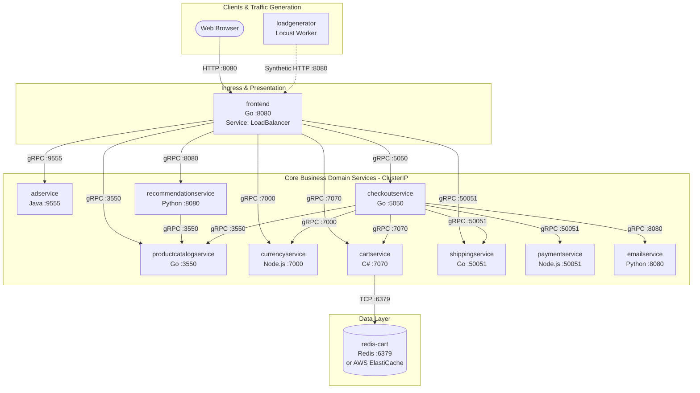
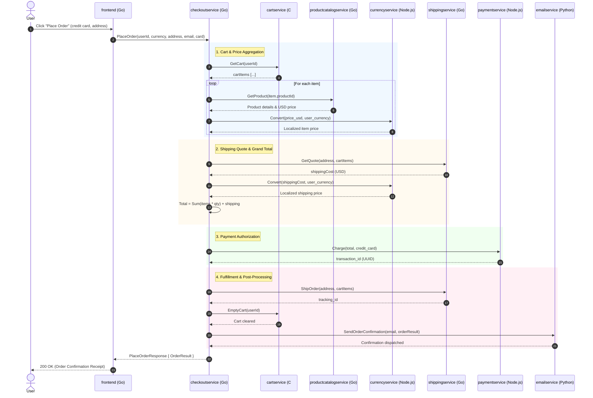

# Online Boutique - Cloud-Native Microservices Architecture & AWS DevOps Guide

A production-grade, cloud-native e-commerce microservices platform demonstrating modern distributed systems architecture, polyglot containerization, gRPC inter-service communication, Kubernetes orchestration, GitOps delivery, and enterprise AWS DevOps practices.

---

## 1. Executive Summary & Architectural Overview

**Online Boutique** is a cloud-first e-commerce demo application simulating a real-world digital retail storefront. Users can browse items, view product details, select foreign currencies, add products to a persistent shopping cart, and execute end-to-end checkout transactions.

### Key Architectural Highlights
* **Polyglot Microservices**: 11 core microservices + 1 load generator built across 5 programming languages (**Go**, **C# / .NET**, **Node.js**, **Python**, **Java**).
* **gRPC-First Internal Mesh**: Internal microservices communicate strictly over **gRPC over HTTP/2** with Protocol Buffer serialization ([`protos/demo.proto`](protos/demo.proto)), minimizing latency and network overhead. Only the `frontend` exposes an external HTTP web server.
* **Stateless Application Tier & Externalized State**: All compute containers are completely stateless and run with non-root security contexts. Shopping cart state is externalized to a **Redis** data store.
* **Distributed Saga Orchestration**: The `checkoutservice` acts as a centralized workflow coordinator that orchestrates cart validation, currency conversion, payment processing, shipping calculation, and email confirmation.
* **Graceful Degradation**: Non-critical services (such as `adservice` and `recommendationservice`) degrade gracefully—if either service fails, the `frontend` continues serving product catalog and checkout flows without throwing 500 errors.
* **Target Enterprise Infrastructure**: Tailored for **Amazon Web Services (AWS)** using **Terraform (IaC)**, **Amazon EKS**, **Amazon ECR**, **Jenkins (CI)**, **Argo CD (GitOps CD)**, and **Prometheus & Grafana (Observability)**.

---

## 2. Complete Microservices Inventory

| # | Microservice | Source Directory | Runtime Language | Exposed Port & Protocol | Downstream Dependencies | Health Probe | Primary Responsibility |
| :-: | :--- | :--- | :--- | :--- | :--- | :--- | :--- |
| **1** | **`frontend`** | `src/frontend` | Go 1.25 / 1.27 | `8080` (HTTP) | All 7 core backend services | `httpGet: /_healthz` | Serves HTML web templates, tracks session cookies, and proxies frontend actions to backend gRPC services. |
| **2** | **`cartservice`** | `src/cartservice/src` | C# (.NET 10.0) | `7070` (gRPC) | Redis (`:6379`) | `grpc: 7070` | Stores and retrieves user shopping cart items; persists to Redis with distributed in-memory fallback. |
| **3** | **`productcatalogservice`** | `src/productcatalogservice` | Go 1.25 / 1.27 | `3550` (gRPC) | *None* (reads `products.json`) | `grpc: 3550` | Provides catalog search, listing, and individual product details from a local JSON dataset. |
| **4** | **`currencyservice`** | `src/currencyservice` | Node.js 24 | `7000` (gRPC) | *None* | `grpc: 7000` | Converts money amounts across multiple currencies using European Central Bank exchange rates. |
| **5** | **`paymentservice`** | `src/paymentservice` | Node.js 24 | `50051` (gRPC) | *None* | `grpc: 50051` | Validates credit card formats and generates mock payment transaction authorization UUIDs. |
| **6** | **`shippingservice`** | `src/shippingservice` | Go 1.26 / 1.27 | `50051` (gRPC) | *None* | `grpc: 50051` | Quotes shipping fees based on item quantities; generates package tracking codes. |
| **7** | **`emailservice`** | `src/emailservice` | Python 3.14 | `8080` (gRPC) | *None* | `grpc: 8080` | Renders HTML order confirmation receipts via Jinja2 templates and simulates email dispatch. |
| **8** | **`checkoutservice`** | `src/checkoutservice` | Go 1.25 / 1.27 | `5050` (gRPC) | Cart, Catalog, Currency, Payment, Shipping, Email | `grpc: 5050` | Central orchestrator executing the distributed checkout saga across all fulfillment microservices. |
| **9** | **`recommendationservice`** | `src/recommendationservice` | Python 3.14 | `8080` (gRPC) | Product Catalog | `grpc: 8080` | Generates 5 randomized product recommendations excluding items already in the user's cart. |
| **10** | **`adservice`** | `src/adservice` | Java 21 / 25 | `9555` (gRPC) | *None* | `grpc: 9555` | Serves targeted advertisement banners matched to product category keywords. |
| **11** | **`redis-cart`** | *Standard Image* | Redis 7 (Alpine) | `6379` (TCP) | *None* | `tcpSocket: 6379` | In-memory key-value database persisting cart items for `cartservice`. |
| **12** | **`loadgenerator`** | `src/loadgenerator` | Python 3.14 / Locust | *Client Only* | Frontend (`:8080`) | *None (Worker)* | Continuously sends synthetic customer browsing, cart mutation, and checkout requests to the frontend. |
| **13** | **`shoppingassistantservice`** | `src/shoppingassistantservice` | Python 3.14 / Flask | `8080` (HTTP) | Google Gemini & AlloyDB | `tcpSocket: 8080` | *Optional demo*: AI conversational assistant using multimodal RAG and vector embeddings. |

---

## 3. Service Communication Mesh & Architecture Diagram



### Service Discovery Mechanics
Within the Kubernetes cluster, services discover each other using **CoreDNS**:
* Environment variables injected into each pod tell the client binary what internal DNS name to call (e.g. `CART_SERVICE_ADDR="cartservice:7070"`).
* CoreDNS resolves `cartservice` to the stable internal virtual IP of the `cartservice` `ClusterIP` Service, which automatically load-balances across healthy backend Pod replicas.

---

## 4. Local Execution with Docker Compose (`compose.yaml`)

The repository includes a battle-tested [`compose.yaml`](compose.yaml) configured to build and spin up the complete polyglot application locally or on an EC2 instance.

### Key Docker Compose Engineering Lessons
1. **The Google Cloud Profiler AWS Crash**:
   By default, Node.js services (`currencyservice`, `paymentservice`) try to start `@google-cloud/profiler`. On AWS EC2 or local Docker, they cannot reach the Google metadata server and crash with exit code `1`. Setting `DISABLE_PROFILER=1` in their environment fixes this issue.
2. **Host Port Collisions**:
   Only `frontend` binds `"8080:8080"` to the host machine. All internal microservices run without host port mapping, communicating cleanly over the private bridge network (`boutique-network`).
3. **Cart Service Build Context**:
   The `Dockerfile` for `cartservice` is located in `./src/cartservice/src/Dockerfile`. Its build context must be `./src/cartservice/src`.

### Running the Application with Docker Compose

```bash
# 1. Start all 12 containers in detached mode
docker compose up -d

# 2. Check that all containers are healthy and "Up"
docker ps

# 3. Access the web store in your browser
# Local machine: http://localhost:8080
# AWS EC2: http://<EC2-PUBLIC-IP>:8080 (Ensure port 8080 is open in Security Group)

# 4. View real-time logs
docker compose logs -f frontend

# 5. Stop the application
docker compose down
```

---

## 5. Kubernetes Manifests Architecture (`k8s/`)

Every microservice has a dedicated, production-grade Kubernetes manifest inside [`k8s/`](k8s/):

```
k8s/
├── adservice.yaml                  # Java gRPC ad service (ClusterIP :9555)
├── cartservice.yaml                # C# .NET gRPC cart service (ClusterIP :7070)
├── checkoutservice.yaml            # Go gRPC orchestrator (ClusterIP :5050)
├── currencyservice.yaml            # Node.js gRPC exchange service (ClusterIP :7000)
├── emailservice.yaml               # Python gRPC email service (ClusterIP :8080)
├── frontend.yaml                   # Go HTTP web store (LoadBalancer :8080)
├── loadgenerator.yaml              # Python Locust client (Deployment only)
├── paymentservice.yaml             # Node.js gRPC payment service (ClusterIP :50051)
├── productcatalogservice.yaml      # Go gRPC catalog service (ClusterIP :3550)
├── recommendationservice.yaml      # Python gRPC recommendation service (ClusterIP :8080)
├── redis.yaml                      # Redis cache store (ClusterIP :6379)
├── shippingservice.yaml            # Go gRPC shipping service (ClusterIP :50051)
└── shoppingassistantservice.yaml   # Python Flask assistant (ClusterIP :8080)
```

### Critical Kubernetes Design Rules & Gotchas

#### 1. The `/_healthz` Underscore Trap (`frontend.yaml`)
In [`src/frontend/main.go`](src/frontend/main.go#L161), the HTTP health check route is registered as `/_healthz` with a **leading underscore**:
```go
r.HandleFunc(baseUrl+"/_healthz", func(w http.ResponseWriter, _ *http.Request) { fmt.Fprint(w, "ok") })
```
If you configure `path: /healthz` (without the underscore), the Gorilla Mux router treats `"healthz"` as a dynamic product ID (`/product/{id}`), fails to find that product in catalog, and returns an **HTTP 500 error**, sending the pod into `CrashLoopBackOff`. Always use `path: "/_healthz"`.

#### 2. Probe Protocol Alignment
* **HTTP Services (`frontend`)**: Must use `httpGet: path: "/_healthz", port: 8080`.
* **gRPC Services (`adservice`, `cartservice`, `checkoutservice`, `currencyservice`, `emailservice`, `paymentservice`, `productcatalogservice`, `recommendationservice`, `shippingservice`)**: Must use native `grpc: port: <PORT>`. Standard HTTP probes will fail against gRPC ports.
* **TCP Services (`redis-cart`, `shoppingassistantservice`)**: Must use `tcpSocket: port: <PORT>`.

#### 3. The `mustMapEnv` Panic Mechanism (`checkoutservice.yaml` & `frontend.yaml`)
In Go services, environment variables are read using `mustMapEnv()`:
```go
func mustMapEnv(target *string, envKey string) {
    v := os.Getenv(envKey)
    if v == "" {
        panic(fmt.Sprintf("environment variable %q not set", envKey))
    }
    *target = v
}
```
If any downstream address is missing from the `env:` block in your Deployment manifest, the Go runtime triggers an immediate fatal panic on boot. All addresses must be explicitly mapped.

#### 4. CoreDNS Service Naming
* `cartservice` expects Redis at `REDIS_ADDR="redis-cart:6379"`. Therefore, the Redis Service must have `metadata.name: redis-cart` (not `redis`).
* `frontend` and `checkoutservice` expect `CART_SERVICE_ADDR="cartservice:7070"`. Therefore, the Cart Service must have `metadata.name: cartservice` (not `cartservice-service`).

#### 5. Client vs. Server Workloads (`loadgenerator.yaml`)
`loadgenerator` only sends traffic *out* to `frontend:8080`. It has no listening server. Therefore:
* It requires **no Service**.
* It requires **no ports**.
* It requires **no health probes**.

#### 6. Container Hardening & Security Contexts
* `readOnlyRootFilesystem: true` must be defined under `spec.containers[*].securityContext` (container level), not at the Pod level (`spec.securityContext`).
* Pod level carries `runAsNonRoot: true` and `runAsUser: 1000`.

### Deploying the Kubernetes Manifests

```bash
# 1. Apply all manifests to your Kubernetes cluster
kubectl apply -f ./k8s/

# 2. Monitor pod rollout
kubectl get pods -w

# 3. Check services
kubectl get svc

# 4. Access the store
# If using a cloud provider (AWS EKS):
kubectl get svc frontend -o jsonpath='{.status.loadBalancer.ingress[0].hostname}'
# If using local Minikube / Docker Desktop:
kubectl port-forward deployment/frontend-deployment 8080:8080
```

---

## 6. End-to-End Distributed User Journeys

### Journey 1: Home Page Browsing (`GET /`)
1. User visits `/`.
2. `frontend` checks/issues a cookie-based session ID (`shop_session-id`).
3. Concurrently calls:
   * `currencyservice.GetSupportedCurrencies()`
   * `productcatalogservice.ListProducts()`
   * `cartservice.GetCart(sessionID)`
   * `adservice.GetAds(["clothing", "accessories"])`
4. Converts all product prices to user currency via `currencyservice.Convert()`.
5. Renders HTML server-side and serves browser.

### Journey 2: The Checkout Saga (`POST /cart/checkout`)
This is the primary distributed transaction in the system managed by `checkoutservice.PlaceOrder()`:



---

## 7. AWS Production Architecture Blueprint

```
+--------------------------------------------------------------------------------------------------+
|                                           AWS Cloud                                              |
|                                                                                                  |
|  +--------------------+         +-------------------------------------------------------------+  |
|  |     Amazon ECR     |         |                     Amazon EKS Cluster                      |  |
|  |                    |         |                                                             |  |
|  | 11 Private Repos   | ------> |  +-------------------------------------------------------+  |  |
|  |                    |         |  |                       Argo CD                         |  |  |
|  | - frontend:tag     |         |  |          (Watches Git manifests repository            |  |  |
|  | - checkout:tag     |         |  |           and syncs rolling updates to EKS)           |  |  |
|  | - [...]            |         |  +--------------------------+----------------------------+  |  |
|  +--------------------+         |                             |                               |  |
|           ^                     |                             v                               |  |
|           | (Docker Push)       |  +-------------------------------------------------------+  |  |
|  +--------------------+         |  |                 Online Boutique Pods                  |  |  |
|  |    Jenkins CI      |         |  |          (11 microservices + in-cluster Redis)        |  |  |
|  |                    |         |  +--------------------------+----------------------------+  |  |
|  | - Builds Docker    |         |                             |                               |  |
|  | - Runs Trivy scan  |         |                             v                               |  |
|  | - Pushes to ECR    |         |  +-------------------------------------------------------+  |  |
|  | - Commits to Git   |         |  |                 Prometheus & Grafana                  |  |  |
|  +--------------------+         |  |           (kube-prometheus-stack Operator)            |  |  |
|           ^                     |  +-------------------------------------------------------+  |  |
|           | (Merge to main)     |                                                             |  |
|  +--------------------+         |  +-------------------------------------------------------+  |  |
|  |   GitHub Actions   |         |  |      AWS Load Balancer Controller (ALB Ingress)       |  |  |
|  | (PR Lint & Test)   |         |  +-------------------------------------------------------+  |  |
|  +--------------------+         +-------------------------------------------------------------+  |
|                                                                                                  |
|  +------------------------------------------------+    +--------------------------------------+  |
|  |              Amazon VPC (Multi-AZ)             |    |        Amazon ElastiCache Redis      |  |
|  |  - Public Subnets (ALB & NAT Gateways)         |    |    (Optional HA production backend   |  |
|  |  - Private Subnets (EKS Worker Nodes)          |    |     replacing in-cluster Redis)      |  |
|  +------------------------------------------------+    +--------------------------------------+  |
+--------------------------------------------------------------------------------------------------+
```

### 1. Infrastructure via Terraform (`terraform/`)
* **VPC**: 3 Availability Zones, public subnets for external ALBs and NAT Gateways, private subnets for EKS worker nodes and ElastiCache.
* **Amazon EKS**: Managed Kubernetes cluster (v1.28+) running managed node groups (`t3.large` or `m5.large`).
* **Amazon ECR**: 11 private container repositories with vulnerability scanning on push and automated lifecycle rules.
* **Amazon ElastiCache for Redis** *(Production)*: Multi-AZ Redis replication group providing managed in-memory persistence.
* **IAM Roles for Service Accounts (IRSA)**: Grants Kubernetes service accounts least-privilege AWS permissions using OIDC federation.

### 2. CI/CD Architecture (Jenkins + Argo CD)
* **GitHub Actions (Fast Developer Feedback)**:
  * Triggers on Pull Requests.
  * Runs unit tests (`product_catalog_test.go`, `shippingservice_test.go`), code formatting, and linters.
* **Jenkins (Build & Artifact Promotion)**:
  * Triggers on merge to `main`.
  * Builds multi-stage Docker images.
  * Runs vulnerability scanning with Trivy.
  * Authenticates via AWS CLI and pushes tagged images (`${BUILD_NUMBER}-${GIT_COMMIT}`) to Amazon ECR.
  * Updates the image tags in the Kubernetes manifests repository and commits changes.
* **Argo CD (GitOps Continuous Delivery)**:
  * Runs inside the EKS cluster (`argocd` namespace).
  * Automatically detects updated manifests in Git and initiates zero-downtime rolling deployments on EKS.
  * Enforces self-healing to eliminate manual configuration drift.

### 3. Observability (Prometheus & Grafana)
* Deployed using the `kube-prometheus-stack` Helm chart.
* **Cluster Metrics**: Node Exporter (CPU, RAM, Disk I/O) and `kube-state-metrics` (pod restarts, crash loops).
* **Application Metrics**: Scraped via `ServiceMonitors` for Go runtime goroutines, JVM garbage collection pauses (`adservice`), and Node.js event loop latency.
* **RED Metrics**: Request Rate (QPS), Error rates (HTTP 5xx / gRPC status codes), and Request Duration (p50/p95/p99 latency histograms).

---

## 8. Common Gotchas & Troubleshooting Cheat Sheet

| Symptom / Error | Root Cause | Immediate Fix |
| :--- | :--- | :--- |
| `no space left on device` during Docker build on EC2 | EBS root volume (8–20 GB default) ran out of disk space during .NET 10 / Java SDK extraction. | Increase EBS volume in AWS Console to 35–40 GB, run `sudo growpart` and `sudo resize2fs`, then run `docker system prune -a --volumes -f`. |
| `currencyservice` or `paymentservice` in `Exited (1)` | `@google-cloud/profiler` fails outside Google Cloud. | Add `DISABLE_PROFILER: "1"` to their environment variables. |
| `frontend` returns `500 Internal Server Error` on `_healthz` | Probe path specified as `/healthz` without leading underscore. | Change probe path in `frontend.yaml` to `path: "/_healthz"`. |
| `frontend` crashes with `panic: environment variable "X" not set` | Missing required downstream service address environment variable. | Ensure all 10 `*_SERVICE_ADDR` variables are defined in `frontend.yaml` (including `SHOPPING_ASSISTANT_SERVICE_ADDR`). |
| `checkoutservice` crashes with `panic` on startup | Missing one of the 6 fulfillment service addresses. | Add all 6 downstream service addresses to `checkoutservice.yaml`. |
| `cartservice` fails to resolve Redis | Redis service named `redis` while cart expects `redis-cart:6379`. | Rename Redis service metadata to `name: redis-cart` in `redis.yaml`. |
| Pod probe fails with `connection reset` or stream error on frontend | Using `grpc:` probe on frontend instead of HTTP. | Change frontend probe to `httpGet: path: "/_healthz", port: 8080`. |
| Kubernetes rejects `loadgenerator` | Empty ports or probes defined on a client workload. | Remove `Service`, `ports:`, and probes from `loadgenerator.yaml`. |
| `shoppingassistantservice` crashes with `KeyError: 'PROJECT_ID'` | Requires Google Cloud AlloyDB and Secret Manager credentials. | This service is optional; all core shopping features function 100% without it. |

---

## 9. License

This project is licensed under the [Apache 2.0 License](LICENSE).
