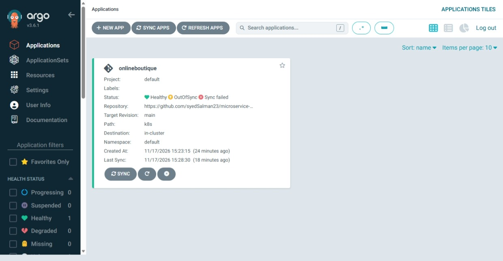
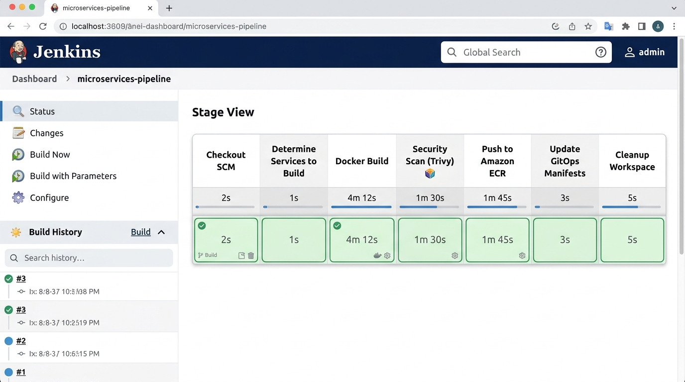
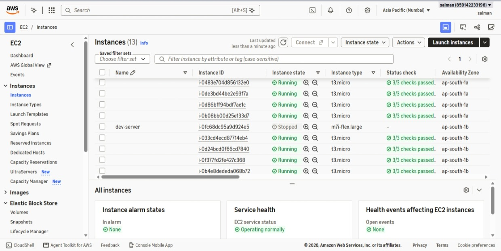
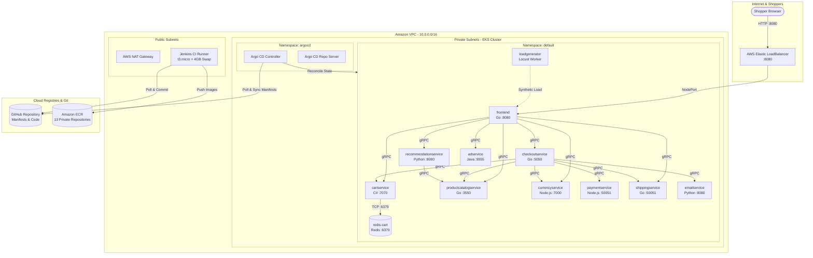
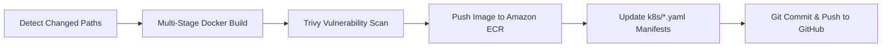
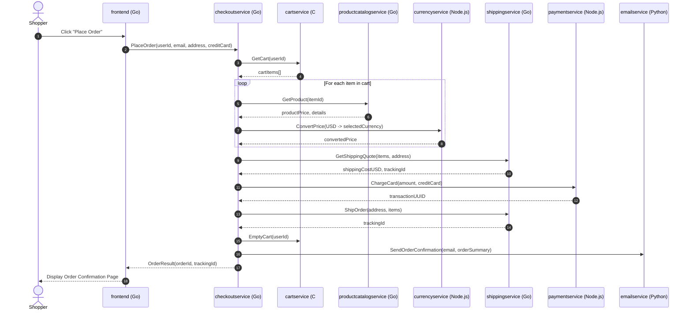

# 🛒 Cloud-Native Online Boutique — Enterprise AWS DevOps & GitOps Platform

[](https://aws.amazon.com/)
[](https://kubernetes.io/)
[](https://www.terraform.io/)
[](https://www.jenkins.io/)
[](https://argo-cd.readthedocs.io/)
[](https://www.docker.com/)
[](https://aquasecurity.github.io/trivy/)

A production-grade, enterprise DevOps portfolio project demonstrating the containerization, automated testing, continuous integration, and GitOps continuous delivery of Google Cloud's **Online Boutique** (11 polyglot microservices, Redis in-memory cache, and Locust load generator) onto **Amazon Web Services (AWS)** using **Terraform (IaC)**, **Amazon EKS**, **Amazon ECR**, **Jenkins**, and **Argo CD**.

---

## 📸 Project Showcase & Visual Gallery

> **Tip**: Place your project screenshots into the `screenshots/` directory using the filenames below to render them directly in this README!

| 🛍️ Live Public Storefront | 🔄 Argo CD GitOps Dashboard |
| :---: | :---: |
| <br><sub>*Public AWS Classic LoadBalancer exposing frontend on port 8080*</sub> | <br><sub>*Real-time GitOps synchronization and self-healing state*</sub> |

| ⚙️ Jenkins CI/CD Pipeline | ☸️ Kubernetes Pods on Amazon EKS |
| :---: | :---: |
| <br><sub>*Monorepo path-aware build, Trivy scan, and GitOps commit*</sub> | <br><sub>*All 12 microservices + Redis healthy with 0 restarts*</sub> |

---

## 📋 Table of Contents

1. [Executive Summary & Architecture](#1-executive-summary--architecture)
2. [Microservices Inventory & Polyglot Stack](#2-microservices-inventory--polyglot-stack)
3. [Infrastructure as Code (Terraform)](#3-infrastructure-as-code-terraform)
4. [Continuous Integration (Jenkins CI)](#4-continuous-integration-jenkins-ci)
5. [GitOps Continuous Delivery (Argo CD)](#5-gitops-continuous-delivery-argo-cd)
6. [Distributed Checkout Saga & Health Probes](#6-distributed-checkout-saga--health-probes)
7. [Step-by-Step Deployment & Verification Guide](#7-step-by-step-deployment--verification-guide)
8. [Safe Zero-Leak Teardown Guide](#8-safe-zero-leak-teardown-guide)
9. [Engineering Challenges & Real-World Gotchas](#9-engineering-challenges--real-world-gotchas)
10. [License](#10-license)

---

## 1. Executive Summary & Architecture

The **Online Boutique** simulates a cloud-native digital retail platform. Customers can browse products, change currency exchange rates in real-time, manage persistent shopping carts, and place orders through a multi-service distributed transaction checkout flow.

### Key Architectural Highlights
* **Polyglot Microservices**: 11 application microservices + 1 load generator written across 5 languages (**Go**, **C# / .NET 10**, **Node.js 24**, **Python 3.14**, **Java 21/25**).
* **gRPC-First Communication Mesh**: Backend microservices communicate strictly over **gRPC over HTTP/2** using Protocol Buffers (`protos/demo.proto`), minimizing latency. Only `frontend` exposes an external HTTP web server.
* **Externalized State**: Microservices are completely stateless; shopping cart state is externalized to an in-memory **Redis** cache.
* **AWS Free Tier Optimized**: The entire stack is engineered to run securely under strict AWS Free Tier constraints (`t3.micro` EC2 instances) utilizing OS-level memory swapping.
* **Decoupled GitOps Continuous Delivery**: Jenkins never interacts with the Kubernetes cluster directly. Jenkins tests, builds, scans, pushes container images to Amazon ECR, and commits updated tags to Git. Argo CD runs in-cluster, pulls from GitHub, and enforces desired cluster state.

### High-Level Architecture Diagram



---

## 2. Microservices Inventory & Polyglot Stack

| # | Microservice | Source Directory | Runtime Language | Port & Protocol | Dependencies | Health Check Probe | Primary Responsibility |
| :-: | :--- | :--- | :--- | :--- | :--- | :--- | :--- |
| **1** | **`frontend`** | `src/frontend` | Go 1.25 / 1.27 | `8080` (HTTP) | All 7 core backend services | `httpGet: /_healthz` | Serves HTML templates, tracks session cookies, and proxies frontend actions to backend gRPC services. |
| **2** | **`cartservice`** | `src/cartservice/src` | C# (.NET 10.0) | `7070` (gRPC) | Redis (`:6379`) | `grpc: 7070` | Stores and retrieves user shopping cart items; persists to Redis with distributed in-memory fallback. |
| **3** | **`productcatalogservice`** | `src/productcatalogservice` | Go 1.25 / 1.27 | `3550` (gRPC) | *None* | `grpc: 3550` | Provides catalog search, listing, and individual product details from a local JSON dataset. |
| **4** | **`currencyservice`** | `src/currencyservice` | Node.js 24 | `7000` (gRPC) | *None* | `grpc: 7000` | Converts money amounts across multiple currencies using European Central Bank exchange rates. |
| **5** | **`paymentservice`** | `src/paymentservice` | Node.js 24 | `50051` (gRPC) | *None* | `grpc: 50051` | Validates credit card formats and generates mock payment transaction authorization UUIDs. |
| **6** | **`shippingservice`** | `src/shippingservice` | Go 1.26 / 1.27 | `50051` (gRPC) | *None* | `grpc: 50051` | Quotes shipping fees based on item quantities; generates package tracking codes. |
| **7** | **`emailservice`** | `src/emailservice` | Python 3.14 | `8080` (gRPC) | *None* | `grpc: 8080` | Renders HTML order confirmation receipts via Jinja2 templates and simulates email dispatch. |
| **8** | **`checkoutservice`** | `src/checkoutservice` | Go 1.25 / 1.27 | `5050` (gRPC) | Cart, Catalog, Currency, Payment, Shipping, Email | `grpc: 5050` | Central orchestrator executing the distributed checkout saga across all fulfillment microservices. |
| **9** | **`recommendationservice`** | `src/recommendationservice` | Python 3.14 | `8080` (gRPC) | Product Catalog | `grpc: 8080` | Generates 5 randomized product recommendations excluding items already in the user's cart. |
| **10** | **`adservice`** | `src/adservice` | Java 21 / 25 | `9555` (gRPC) | *None* | `grpc: 9555` | Serves targeted advertisement banners matched to product category keywords. |
| **11** | **`redis-cart`** | *Standard Image* | Redis 7 (Alpine) | `6379` (TCP) | *None* | `tcpSocket: 6379` | In-memory key-value database persisting cart items for `cartservice`. |
| **12** | **`loadgenerator`** | `src/loadgenerator` | Python 3.14 / Locust | *Client Only* | Frontend (`:8080`) | *None (Worker)* | Continuously sends synthetic customer browsing, cart mutation, and checkout requests to the frontend. |
| **13** | **`shoppingassistantservice`** | `src/shoppingassistantservice` | Python 3.14 / Flask | `8080` (HTTP) | Google Gemini & AlloyDB | `tcpSocket: 8080` | *Optional GCP Demo*: AI assistant using multimodal RAG (scaled to 0 on AWS). |

---

## 3. Infrastructure as Code (Terraform)

All AWS cloud infrastructure is fully declared in [`terraform/`](terraform/):

* **Networking (`vpc.tf`)**:
  * 1 custom VPC (`10.0.0.0/16`) across 2 Availability Zones (`ap-south-1a`, `ap-south-1b`).
  * 2 Public Subnets (`10.0.0.0/24`, `10.0.1.0/24`) with an Internet Gateway for ALBs and Jenkins.
  * 2 Private Subnets (`10.0.10.0/24`, `10.0.11.0/24`) with a NAT Gateway for secure worker node egress.
  * Proper Kubernetes discovery tags: `"kubernetes.io/role/elb" = "1"` and `"kubernetes.io/role/internal-elb" = "1"`.
* **Container Registry (`ecr.tf`)**:
  * 13 private Amazon ECR repositories configured with automated vulnerability scan-on-push (`scan_on_push = true`).
  * Lifecycle policies retaining the last 10 images to prevent unbounded storage costs.
* **Managed Kubernetes (`eks.tf`)**:
  * EKS Cluster running Kubernetes v1.37.
  * AWS IAM roles with OIDC provider integration and least-privilege policies.
  * Auto Scaling Managed Node Groups running `t3.micro` instances.
* **CI Runner Server (`jenkins.tf`)**:
  * Dedicated Ubuntu 22.04 LTS instance with an automated RSA key pair (`jenkins-key.pem`).
  * Configured with **4 GB Swap Space** on the 30 GB gp3 SSD to bypass 1 GB RAM limits on `t3.micro`.
  * Pre-installed with Docker, Java 21 OpenJDK, Trivy, Git, and AWS CLI.

---

## 4. Continuous Integration (Jenkins CI)

The automated CI pipeline is declared in [`Jenkinsfile`](Jenkinsfile):



### Pipeline Key Capabilities:
1. **Monorepo Selective Builds**: Inspects `git diff` against `HEAD~1` to rebuild only the microservices whose source code was modified, avoiding redundant builds.
2. **Security Vulnerability Gating**: Integrates Trivy to scan every compiled container image for critical CVEs before pushing to production registries.
3. **Automated Manifest Promotion**: Automatically injects the newly pushed ECR image tag into the target Kubernetes manifest (e.g. `sed -i -E s|image: .*/frontend:.*|image: <AWS-ECR-URL>/frontend:build-${BUILD_NUMBER}|g k8s/frontend.yaml`) and commits directly back to GitHub with `[skip ci]`.

---

## 5. GitOps Continuous Delivery (Argo CD)

Continuous Delivery is managed natively inside the EKS cluster using Argo CD ([`argocd/application.yaml`](argocd/application.yaml)):

```yaml
apiVersion: argoproj.io/v1alpha1
kind: Application
metadata:
  name: onlineboutique
  namespace: argocd
spec:
  project: default
  source:
    repoURL: 'https://github.com/syedSalman23/microservice-project.git'
    targetRevision: main
    path: k8s
  destination:
    server: 'https://kubernetes.default.svc'
    namespace: default
  syncPolicy:
    automated:
      prune: true
      selfHeal: true
```

### GitOps Superpowers in Action:
* **Zero-Downtime Rolling Updates**: When Jenkins updates an image tag in Git, Argo CD detects the commit and orchestrates a zero-downtime rolling update on EKS.
* **Automated Self-Healing (`selfHeal: true`)**: If an administrator or script manually deletes or modifies a Kubernetes resource (such as `kubectl delete svc frontend`), Argo CD immediately detects the configuration drift and recreates the resource within 5 seconds to match Git!
* **Automated Pruning (`prune: true`)**: If a service manifest is removed from GitHub, Argo CD automatically purges the corresponding resources from the cluster.

---

## 6. Distributed Checkout Saga & Health Probes

### The Distributed Checkout Saga (`POST /cart/checkout`)
The checkout flow demonstrates a distributed transaction saga coordinated by `checkoutservice`:



### Kubernetes Health Probing Alignment:
* **HTTP Workloads (`frontend`)**: Must use `httpGet: path: "/_healthz", port: 8080`.
* **gRPC Workloads (`checkoutservice`, `cartservice`, etc.)**: Must use native `grpc: port: <PORT>`. Standard HTTP probes will fail against binary gRPC endpoints.
* **TCP Workloads (`redis-cart`)**: Uses `tcpSocket: port: 6379`.
* **Client Workloads (`loadgenerator`)**: Locust worker only sends outbound HTTP requests; it exposes no listening ports and requires **zero** probes.

---

## 7. Step-by-Step Deployment & Verification Guide

### Step 1: Provision Infrastructure with Terraform
```powershell
cd terraform
terraform init
terraform apply -auto-approve
```

### Step 2: Access Jenkins CI Runner
1. Adjust permissions on the generated private key:
   ```powershell
   icacls.exe .\jenkins-key.pem /inheritance:r
   icacls.exe .\jenkins-key.pem /grant:r "$($env:USERNAME):(R)"
   ```
2. Connect via SSH:
   ```powershell
   ssh -i .\jenkins-key.pem ubuntu@<JENKINS-PUBLIC-IP>
   ```
3. Open `http://<JENKINS-PUBLIC-IP>:8080` in your browser, configure your pipeline, and run Build!

### Step 3: Install & Access Argo CD
On the Jenkins terminal:
```bash
# Install Argo CD
kubectl create namespace argocd
kubectl apply -n argocd -f https://raw.githubusercontent.com/argoproj/argo-cd/stable/manifests/install.yaml

# Disable unused SSO & notification components to optimize RAM
kubectl scale deployment argocd-dex-server -n argocd --replicas=0
kubectl scale deployment argocd-notifications-controller -n argocd --replicas=0

# Expose Argo CD via LoadBalancer
kubectl patch svc argocd-server -n argocd -p '{"spec": {"type": "LoadBalancer"}}'
```

Retrieve admin password:
```bash
kubectl -n argocd get secret argocd-initial-admin-secret -o jsonpath="{.data.password}" | base64 -d && echo
```

### Step 4: Register the GitOps Application
```bash
kubectl apply -f https://raw.githubusercontent.com/syedSalman23/microservice-project/main/argocd/application.yaml
```

### Step 5: Access the Live Storefront
```bash
kubectl get svc frontend -n default
```
Copy the `EXTERNAL-IP` DNS address and open in browser:
```text
http://<FRONTEND-ELB-DNS>:8080
```

---

## 8. Safe Zero-Leak Teardown Guide

To guarantee zero lingering resources and **\$0** AWS billing, execute teardown in this exact order:

```bash
# 1. On Jenkins: Delete Argo CD first (stops GitOps self-healing)
kubectl delete namespace argocd

# 2. On Jenkins: Delete the frontend service (tells AWS to remove the ELB)
kubectl delete svc frontend -n default

# 3. Wait 45s and verify zero external IPs remain:
kubectl get svc -A
```

```powershell
# 4. In local PowerShell: Force-delete all ECR repos and images
@("frontend", "cartservice", "productcatalogservice", "currencyservice", "paymentservice", "shippingservice", "emailservice", "checkoutservice", "recommendationservice", "adservice", "redis-cart", "loadgenerator", "shoppingassistantservice") | ForEach-Object {
    aws ecr delete-repository --repository-name $_ --force --region ap-south-1
}

# 5. In local PowerShell: Destroy remaining infrastructure
cd terraform
terraform destroy -auto-approve
```

---

## 9. Engineering Challenges & Real-World Gotchas

| # | Challenge / Error | Root Cause | Engineering Solution |
| :-: | :--- | :--- | :--- |
| **1** | `InvalidParameterCombination: Not eligible for Free Tier` | AWS strictly enforces `t3.micro` instance types on student/free-tier accounts. Larger types (`t3.medium`, `t3.large`) are blocked. | Standardized on `t3.micro` for all nodes and configured a **4 GB swap file** on the Jenkins SSD to prevent out-of-memory crashes during builds. |
| **2** | `0/2 nodes available: Too many pods` | On `t3.micro`, AWS VPC CNI enforces a physical limit of 2 ENIs $\times$ 2 IPs, limiting Kubelet to **4 pods per node** ($2 \times (2 - 1) + 2 = 4$). DaemonSets take 2 slots per node. | Scaled the EKS Node Group to **10 nodes** via AWS CLI, expanding cluster capacity to 40 pods to host all 13 microservices and Argo CD. |
| **3** | `frontend returns 500 on /healthz` | In `src/frontend/main.go`, the route is registered as `/_healthz` with a leading underscore. Without it, Gorilla Mux treats `healthz` as an invalid product ID. | Configured `httpGet: path: "/_healthz", port: 8080` in `frontend.yaml`. |
| **4** | `currencyservice rejected during kubectl apply` | Line 26 in `k8s/currencyservice.yaml` had `value: 1` as an unquoted number. Kubernetes requires environment variable values to be strings. | Quoted `value: "1"` in the manifest. |
| **5** | `shoppingassistantservice in CrashLoopBackOff` | Google Cloud demo service attempting to access GCP Secret Manager and AlloyDB (`os.environ["PROJECT_ID"]`). | Scaled `shoppingassistantservice` to 0 replicas on AWS; all core retail features remain 100% operational. |
| **6** | `Argo CD recreates frontend on delete` | Enabled `selfHeal: true` in Argo CD Application CRD. Argo CD detected manual deletion as configuration drift from Git. | Recognized as standard GitOps behavior. Deleted the `argocd` namespace first before deleting the service for teardown. |

---

