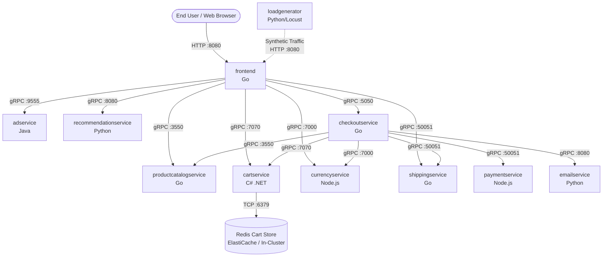

# Online Boutique - Cloud-Native Microservices Application

A polyglot e-commerce microservices demo application built with cloud-native principles. This repository contains the core application source code and Protocol Buffer service contracts, prepared for deployment on **Amazon Web Services (AWS)** using **Terraform (IaC)**, **Jenkins (CI)**, **Argo CD (GitOps CD)**, and **Prometheus & Grafana (Monitoring)**.

---

## 1. Architecture Overview

Online Boutique is composed of 11 core microservices written in different languages that communicate with each other over **gRPC** using Protocol Buffers, with a web **frontend** exposing an HTTP interface. An automated **load generator** simulates realistic user shopping behavior.



---

## 2. Microservices Inventory

| Microservice | Language / Runtime | Port / Protocol | Downstream Dependencies | Description |
| :--- | :--- | :--- | :--- | :--- |
| **`frontend`** | Go 1.22 | `8080` (HTTP) | All core services | Serves HTML web templates, manages user session cookies, and routes actions to backend services. |
| **`cartservice`** | C# (.NET 8.0) | `7070` (gRPC) | Redis (`:6379`) | Stores and retrieves user shopping cart items. Supports Redis or fallback distributed in-memory cache. |
| **`productcatalogservice`** | Go 1.22 | `3550` (gRPC) | *None (reads `products.json`)* | Reads product listings from a local JSON file; supports listing, searching, and fetching product details. |
| **`currencyservice`** | Node.js 20 | `7000` (gRPC) | *None* | Converts currencies using European Central Bank exchange rates. Highest query-per-second (QPS) service. |
| **`paymentservice`** | Node.js 20 | `50051` (gRPC) | *None* | Validates credit card details and generates mock transaction confirmation IDs. |
| **`shippingservice`** | Go 1.22 | `50051` (gRPC) | *None* | Calculates shipping cost estimates and returns tracking numbers based on cart contents. |
| **`emailservice`** | Python 3.11 | `8080` (gRPC) | *None* | Sends mock order confirmation emails to users. |
| **`checkoutservice`** | Go 1.22 | `5050` (gRPC) | Cart, Catalog, Currency, Payment, Shipping, Email | Coordinates the full checkout transaction across all fulfillment services. |
| **`recommendationservice`** | Python 3.11 | `8080` (gRPC) | Product Catalog | Generates personalized product recommendations based on items currently in the user's cart. |
| **`adservice`** | Java 21 | `9555` (gRPC) | *None* | Serves contextual advertising banners matched to product category keywords. |
| **`loadgenerator`** | Python (Locust) | *Client-only* | Frontend (`:8080`) | Continuously generates realistic user journeys (browse, add to cart, checkout). |
| **`shoppingassistantservice`** | Python (FastAPI) | `8080` (HTTP) | *Optional Gemini / AlloyDB* | AI assistant utilizing Google Gemini and vector embeddings for semantic product advice. |

---

## 3. Protocol Buffers & gRPC Contracts (`protos/`)

All inter-service gRPC communication is defined in [`protos/demo.proto`](protos/demo.proto):

* `hipstershop.CartService`: `AddItem`, `GetCart`, `EmptyCart`
* `hipstershop.RecommendationService`: `ListRecommendations`
* `hipstershop.ProductCatalogService`: `ListProducts`, `GetProduct`, `SearchProducts`
* `hipstershop.ShippingService`: `GetQuote`, `ShipOrder`
* `hipstershop.PaymentService`: `Charge`
* `hipstershop.EmailService`: `SendOrderConfirmation`
* `hipstershop.CheckoutService`: `PlaceOrder`
* `hipstershop.AdService`: `GetAds`
* Health probes conform to `grpc.health.v1.Health` defined in [`protos/grpc/health/v1/health.proto`](protos/grpc/health/v1/health.proto).

---

## 4. Environment Variables & Configuration Reference

Each service is configured through environment variables:

### `frontend`
* `PORT`: Listening HTTP port (default: `"8080"`)
* `PRODUCT_CATALOG_SERVICE_ADDR`: Address of Product Catalog (e.g., `"productcatalogservice:3550"`)
* `CURRENCY_SERVICE_ADDR`: Address of Currency Service (e.g., `"currencyservice:7000"`)
* `CART_SERVICE_ADDR`: Address of Cart Service (e.g., `"cartservice:7070"`)
* `RECOMMENDATION_SERVICE_ADDR`: Address of Recommendation Service (e.g., `"recommendationservice:8080"`)
* `CHECKOUT_SERVICE_ADDR`: Address of Checkout Service (e.g., `"checkoutservice:5050"`)
* `SHIPPING_SERVICE_ADDR`: Address of Shipping Service (e.g., `"shippingservice:50051"`)
* `AD_SERVICE_ADDR`: Address of Ad Service (e.g., `"adservice:9555"`)
* `SHOPPING_ASSISTANT_SERVICE_ADDR`: Address of Shopping Assistant (optional)
* `ENABLE_TRACING`: Set to `"1"` to enable OpenTelemetry tracing
* `COLLECTOR_SERVICE_ADDR`: OpenTelemetry collector endpoint (e.g., `"otel-collector:4317"`)

### `checkoutservice`
* `PORT`: Listening gRPC port (default: `"5050"`)
* `PRODUCT_CATALOG_SERVICE_ADDR`: Address of Product Catalog (`"productcatalogservice:3550"`)
* `CURRENCY_SERVICE_ADDR`: Address of Currency Service (`"currencyservice:7000"`)
* `CART_SERVICE_ADDR`: Address of Cart Service (`"cartservice:7070"`)
* `SHIPPING_SERVICE_ADDR`: Address of Shipping Service (`"shippingservice:50051"`)
* `PAYMENT_SERVICE_ADDR`: Address of Payment Service (`"paymentservice:50051"`)
* `EMAIL_SERVICE_ADDR`: Address of Email Service (`"emailservice:8080"`)

### `cartservice`
* `PORT`: Listening gRPC port (default: `"7070"`)
* `REDIS_ADDR`: Address of Redis database (e.g., `"redis-cart:6379"` or AWS ElastiCache endpoint). If unset, falls back to in-memory caching.

### `recommendationservice`
* `PORT`: Listening gRPC port (default: `"8080"`)
* `PRODUCT_CATALOG_SERVICE_ADDR`: Address of Product Catalog (`"productcatalogservice:3550"`)

### `loadgenerator`
* `FRONTEND_ADDR`: Base URL of the frontend service (e.g., `"http://frontend:8080"`)
* `USERS`: Number of concurrent simulated shoppers (default: `10`)

---

## 5. Local Container Build & Verification

Each microservice contains a self-contained multi-stage `Dockerfile`. You can build and test any service locally using Docker:

```powershell
# Build frontend
docker build -t onlineboutique-frontend:local ./src/frontend

# Build cartservice
docker build -t onlineboutique-cartservice:local ./src/cartservice/src

# Build checkoutservice
docker build -t onlineboutique-checkoutservice:local ./src/checkoutservice

# Build productcatalogservice
docker build -t onlineboutique-productcatalogservice:local ./src/productcatalogservice

# Build currencyservice
docker build -t onlineboutique-currencyservice:local ./src/currencyservice

# Build paymentservice
docker build -t onlineboutique-paymentservice:local ./src/paymentservice

# Build shippingservice
docker build -t onlineboutique-shippingservice:local ./src/shippingservice

# Build emailservice
docker build -t onlineboutique-emailservice:local ./src/emailservice

# Build recommendationservice
docker build -t onlineboutique-recommendationservice:local ./src/recommendationservice

# Build adservice
docker build -t onlineboutique-adservice:local ./src/adservice

# Build loadgenerator
docker build -t onlineboutique-loadgenerator:local ./src/loadgenerator
```

---

## 6. Target Deployment Blueprint on AWS

```
+---------------------------------------------------------------------------------+
|                               AWS Cloud                                         |
|                                                                                 |
|  +--------------------+         +--------------------------------------------+  |
|  |     Amazon ECR     |         |             Amazon EKS Cluster             |  |
|  |                    |         |                                            |  |
|  | [frontend:tag]     | ------->|  +--------------------------------------+  |  |
|  | [cartservice:tag]  |         |  |             Argo CD                  |  |  |
|  | [checkout:tag]     |         |  |   (Watches Git manifests repo        |  |  |
|  | [payment:tag]      |         |  |    and syncs deployments to EKS)     |  |  |
|  | [...]              |         |  +-------------------+------------------+  |  |
|  +--------------------+         |                      |                     |  |
|            ^                    |                      v                     |  |
|            |                    |  +--------------------------------------+  |  |
|       (Docker Push)             |  |        Online Boutique Pods          |  |  |
|            |                    |  |   (11 microservices + redis-cart)    |  |  |
|  +--------------------+         |  +-------------------+------------------+  |  |
|  |      Jenkins       |         |                      |                     |  |
|  |    (CI Server)     |         |                      v                     |  |
|  |                    |         |  +--------------------------------------+  |  |
|  | - Pulls source     |         |  |        Prometheus & Grafana          |  |  |
|  | - Builds Docker    |         |  |   (kube-prometheus-stack Operator)   |  |  |
|  | - Pushes to ECR    |         |  +--------------------------------------+  |  |
|  | - Updates GitOps   |         |                                            |  |
|  +--------------------+         +--------------------------------------------+  |
|                                                                                 |
+---------------------------------------------------------------------------------+
```

### 1. Infrastructure via Terraform (`terraform/`)
* **VPC**: 3 Availability Zones, public subnets for Application Load Balancers and NAT Gateways, private subnets for EKS worker nodes.
* **Amazon EKS**: Managed Kubernetes cluster with managed node groups (`t3.large` or `m5.large`).
* **Amazon ECR**: Dedicated private container registries for each microservice.
* **Amazon ElastiCache for Redis** *(Optional)*: Managed Redis cluster for externalized `cartservice` state.
* **IAM & IRSA**: IAM Roles for Service Accounts for AWS Load Balancer Controller and ExternalDNS.

### 2. CI Automation via Jenkins (`jenkins/`)
* **Source Trigger**: Webhook on Git push to `main` branch.
* **Container Build**: Automated Docker multi-stage builds.
* **Registry Publish**: Authenticate via AWS CLI and push tagged images to Amazon ECR.
* **GitOps Update**: Update image tags in Kubernetes manifests/Kustomize overlays and commit to the GitOps branch.

### 3. Continuous Delivery via Argo CD (`k8s/`)
* **GitOps Model**: Argo CD deployed in EKS continuously monitors the Kubernetes manifest directory.
* **Automated Sync**: When Jenkins updates image tags in Git, Argo CD executes automated zero-downtime rolling deployments on EKS.
* **Self-Healing**: Detects and remediates manual drift between live cluster state and Git definitions.

### 4. Observability via Prometheus & Grafana (`monitoring/`)
* **Prometheus Operator (`kube-prometheus-stack`)**:
  * Scrapes cluster metrics (CPU, Memory, Disk, Network) via Node Exporter and kube-state-metrics.
  * Scrapes application runtime metrics (Go runtime, JVM garbage collection, Node.js event loop).
  * Monitored RED metrics: **Rate** (requests/sec), **Errors** (HTTP 5xx / gRPC error codes), **Duration** (p50/p95/p99 latency).
* **Grafana Dashboards**: Unified visual dashboards for cluster health, ingress traffic, and service-to-service communication.

---

## 7. License

This project is licensed under the [Apache 2.0 License](LICENSE).
