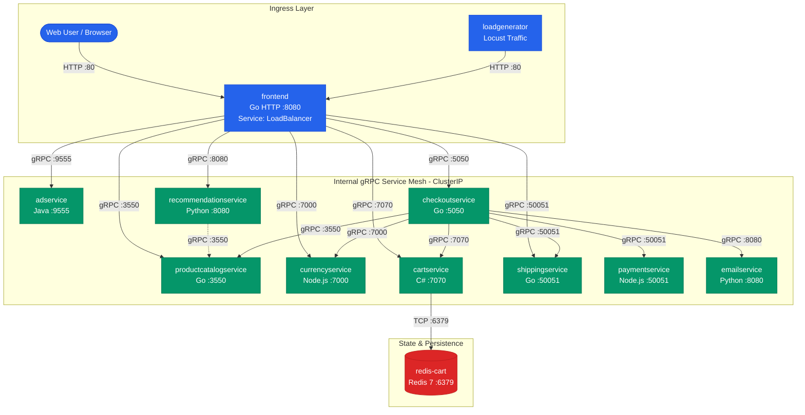
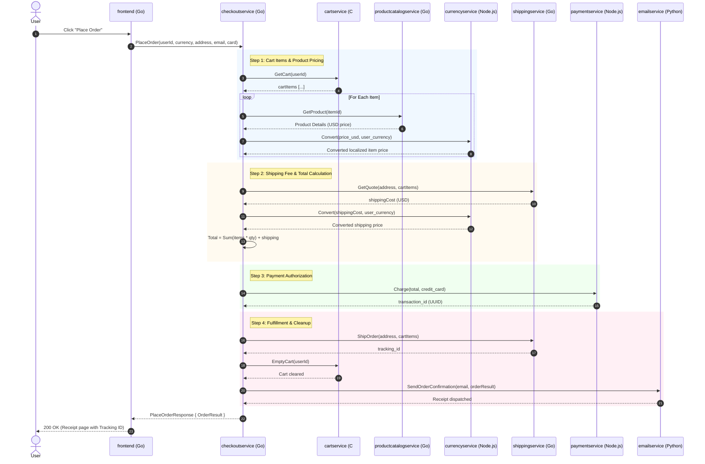

# Online Boutique - Cloud-Native Microservices & AWS Enterprise DevOps Platform


A production-grade, cloud-native e-commerce microservices platform demonstrating distributed systems architecture, polyglot containerization, high-performance gRPC inter-service communication, declarative Infrastructure as Code (Terraform), automated CI pipelines (Jenkins), and continuous GitOps delivery (Argo CD) on Amazon Web Services (AWS).

---

## Table of Contents
1. [Executive Summary & Architectural Pillars](#1-executive-summary--architectural-pillars)
2. [End-to-End System Architecture](#2-end-to-end-system-architecture)
3. [Complete Microservices Inventory](#3-complete-microservices-inventory)
4. [Service Communication Mesh & gRPC Protocols](#4-service-communication-mesh--grpc-protocols)
5. [Distributed Transaction Saga (Checkout Flow)](#5-distributed-transaction-saga-checkout-flow)
6. [Local Containerization with Docker Compose](#6-local-containerization-with-docker-compose)
7. [Kubernetes Manifests Reference Architecture (`k8s/`)](#7-kubernetes-manifests-reference-architecture-k8s)
8. [AWS Cloud Infrastructure via Terraform (`terraform/`)](#8-aws-cloud-infrastructure-via-terraform-terraform)
9. [Continuous Integration Pipeline (`Jenkinsfile`)](#9-continuous-integration-pipeline-jenkinsfile)
10. [GitOps Continuous Delivery (`argocd/`)](#10-gitops-continuous-delivery-argocd)
11. [Cluster & Application Observability](#11-cluster--application-observability)
12. [Troubleshooting & Lessons Learned Cheat Sheet](#12-troubleshooting--lessons-learned-cheat-sheet)
13. [End-to-End Deployment Runbook](#13-end-to-end-deployment-runbook)

---

## 1. Executive Summary & Architectural Pillars

**Online Boutique** simulates an enterprise web retail storefront where users browse products, view localized currency pricing, add items to a shopping cart, and complete purchase orders. 

### Key Architectural Highlights
* **Polyglot Microservices**: 11 business microservices + 1 load generator built across 5 distinct runtimes: **Go**, **C# (.NET 10)**, **Node.js 24**, **Python 3.14**, and **Java 21/25**.
* **gRPC-First High Performance Mesh**: All internal backend microservices communicate strictly over **HTTP/2 with Protocol Buffer serialization** ([`protos/demo.proto`](protos/demo.proto)), eliminating REST/JSON serialization overhead and enabling binary multiplexing. Only the `frontend` exposes an external HTTP web server.
* **Stateless Compute & Externalized Cache**: Application pods are 100% stateless and run with non-root security contexts. Session shopping carts are persisted to an external in-memory **Redis** cluster.
* **Distributed Saga Orchestration**: The `checkoutservice` coordinates multi-service transactions (cart retrieval, price conversion, shipping quotes, payment authorization, and receipt dispatch) without distributed database locks.
* **Graceful Degradation**: Non-critical services (`adservice` and `recommendationservice`) degrade gracefully—if either service fails, the `frontend` continues serving core catalog browsing and checkout functionality.
* **Enterprise AWS Cloud Stack**: Automated provisioning using **Terraform**, container storage in **Amazon ECR**, container orchestration via **Amazon EKS**, automated CI with **Jenkins**, and GitOps CD with **Argo CD**.

---

## 2. End-to-End System Architecture

```
                                  +-------------------------------------------------------------+
                                  |                      DEVELOPER WORKFLOW                     |
                                  |                                                             |
                                  |   [ Developer ] ---> git push ---> [ GitHub Repository ]   |
                                  +---------------------------------------+---------------------+
                                                                          |
                                                       GitHub Webhook /   | Poll (dev / main)
                                                                          v
+-------------------------------------------------------------------------+----------------------------------------------------------+
|                                                      AWS CLOUD (ap-south-1)                                                        |
|                                                                                                                                    |
|  +------------------------------------------------------------------------------------------------------------------------------+  |
|  |                                                 JENKINS CI SERVER (EC2 t3.medium)                                            |  |
|  |                                                                                                                              |  |
|  |  1. Path-Based Detection  --> Inspects git diff to find modified src/<service>/                                             |  |
|  |  2. Docker Multi-Stage    --> Compiles & builds optimized container image (:build-X)                                          |  |
|  |  3. Trivy Security Scan   --> Checks image for HIGH & CRITICAL CVE vulnerabilities                                           |  |
|  |  4. Amazon ECR Push       --> Authenticates via IAM Instance Profile & pushes image                                          |  |
|  |  5. GitOps Manifest Tag   --> Updates k8s/<service>.yaml with new image tag & commits to Git [skip ci]                       |  |
|  +-------------------+----------------------------------------------------------------------------------+-----------------------+  |
|                      |                                                                                  |                          |
|                      v (Docker Push)                                                                    v (Git Commit)             |
|  +-------------------+-------------------+                                              +---------------+---------------+  |
|  |             Amazon ECR                |                                              |       GitHub Repository       |  |
|  |                                       |                                              |                               |  |
|  |  13 Private Container Repositories    |                                              |  k8s/*.yaml with updated tags |  |
|  |  - onlineboutique/frontend:build-X    |                                              +---------------+---------------+  |
|  |  - onlineboutique/checkoutservice:... |                                                              |                          |
|  +-------------------+-------------------+                                                              |                          |
|                      |                                                                                  | (GitOps Sync)            |
|                      | (Pulls Image)                                                                    v                          |
|  +-------------------+----------------------------------------------------------------------------------+-----------------------+  |
|  |                                                    AMAZON EKS CLUSTER (v1.30)                                                |  |
|  |                                                                                                                              |  |
|  |   +----------------------------------------------------------------------------------------------------------------------+   |  |
|  |   |                                                      ARGO CD                                                         |   |  |
|  |   |             Continuously monitors k8s/ in Git. Automatically triggers zero-downtime rolling deployments              |   |  |
|  |   |             Enforces automated Self-Healing: overrides manual configuration drift on the cluster                     |   |  |
|  |   +----------------------------------------------------------+-----------------------------------------------------------+   |  |
|  |                                                              |                                                               |  |
|  |                                                              v (Deploys Pods)                                                |  |
|  |   +----------------------------------------------------------------------------------------------------------------------+   |  |
|  |   |                                               ONLINE BOUTIQUE PODS                                                   |   |  |
|  |   |                                                                                                                      |   |  |
|  |   |   [ frontend ] (LoadBalancer :80 -> :8080)                                                                            |   |  |
|  |   |         │                                                                                                            |   |  |
|  |   |         ├──► [ cartservice ] (:7070) ──► [ redis-cart ] (:6379)                                                      |   |  |
|  |   |         ├──► [ productcatalogservice ] (:3550)                                                                       |   |  |
|  |   |         ├──► [ currencyservice ] (:7000)                                                                             |   |  |
|  |   |         ├──► [ recommendationservice ] (:8080)                                                                       |   |  |
|  |   |         ├──► [ shippingservice ] (:50051)                                                                            |   |  |
|  |   |         ├──► [ adservice ] (:9555)                                                                                   |   |  |
|  |   |         └──► [ checkoutservice ] (:5050)                                                                             |   |  |
|  |   |                     ├──► [ paymentservice ] (:50051)                                                                  |   |  |
|  |   |                     └──► [ emailservice ] (:8080)                                                                    |   |  |
|  |   +----------------------------------------------------------------------------------------------------------------------+   |  |
|  +------------------------------------------------------------------------------------------------------------------------------+  |
+------------------------------------------------------------------------------------------------------------------------------------+
```

---

## 3. Complete Microservices Inventory

| # | Microservice | Directory Path | Language / Runtime | Exposed Port & Protocol | Dependencies | Health Probe | Primary Responsibility |
| :-: | :--- | :--- | :--- | :--- | :--- | :--- | :--- |
| **1** | **`frontend`** | `src/frontend` | Go 1.25 / 1.27 | `8080` (HTTP) | All backend services | `httpGet: /_healthz` | Renders HTML templates, manages HTTP user sessions, handles currency conversion and checkout requests. |
| **2** | **`cartservice`** | `src/cartservice/src` | C# (.NET 10.0) | `7070` (gRPC) | Redis (`:6379`) | `grpc: 7070` | Manages user shopping carts; persists items to external Redis cache with fallback memory store. |
| **3** | **`productcatalogservice`** | `src/productcatalogservice` | Go 1.25 / 1.27 | `3550` (gRPC) | *None* | `grpc: 3550` | Provides product lookup, search indexing, and details parsed from local `products.json`. |
| **4** | **`currencyservice`** | `src/currencyservice` | Node.js 24 | `7000` (gRPC) | *None* | `grpc: 7000` | Calculates localized price conversions using European Central Bank financial rates. |
| **5** | **`paymentservice`** | `src/paymentservice` | Node.js 24 | `50051` (gRPC) | *None* | `grpc: 50051` | Validates credit card formats and generates mock payment transaction authorization UUIDs. |
| **6** | **`shippingservice`** | `src/shippingservice` | Go 1.26 / 1.27 | `50051` (gRPC) | *None* | `grpc: 50051` | Quotes estimated shipping costs based on cart size and generates package tracking IDs. |
| **7** | **`emailservice`** | `src/emailservice` | Python 3.14 | `8080` (gRPC) | *None* | `grpc: 8080` | Compiles HTML order receipts via Jinja2 templates and simulates email delivery. |
| **8** | **`checkoutservice`** | `src/checkoutservice` | Go 1.25 / 1.27 | `5050` (gRPC) | Cart, Catalog, Currency, Payment, Shipping, Email | `grpc: 5050` | Central distributed transaction coordinator executing the 4-phase checkout saga. |
| **9** | **`recommendationservice`** | `src/recommendationservice` | Python 3.14 | `8080` (gRPC) | Product Catalog | `grpc: 8080` | Generates personalized product recommendations excluding items already in cart. |
| **10** | **`adservice`** | `src/adservice` | Java 21 / 25 | `9555` (gRPC) | *None* | `grpc: 9555` | Serves contextual advertisement banners matched to product category keywords. |
| **11** | **`redis-cart`** | *Standard Image* | Redis 7 (Alpine) | `6379` (TCP) | *None* | `tcpSocket: 6379` | In-memory key-value data store providing persistent storage for `cartservice`. |
| **12** | **`loadgenerator`** | `src/loadgenerator` | Python 3.14 / Locust | *Client Only* | Frontend (`:8080`) | *None (Worker)* | Continuously generates realistic customer traffic: browsing, cart mutations, and checkout transactions. |
| **13** | **`shoppingassistantservice`** | `src/shoppingassistantservice` | Python 3.14 / Flask | `8080` (HTTP) | AlloyDB & Gemini | `tcpSocket: 8080` | *Optional demo*: Conversational AI assistant with multimodal RAG embeddings. |

---

## 4. Service Communication Mesh & gRPC Protocols

All internal services communicate strictly via **gRPC over HTTP/2** using protocol buffers defined in [`protos/demo.proto`](protos/demo.proto).



---

## 5. Distributed Transaction Saga (Checkout Flow)

The checkout process coordinates state across 7 microservices without distributed 2-phase commit locking:



---

## 6. Local Containerization with Docker Compose

A production-parity multi-container setup is codified in [`compose.yaml`](compose.yaml).

### Key Architectural Patterns
* **Dedicated Bridge Network (`boutique-net`)**: Containers communicate using internal Docker DNS names (`cartservice:7070`, `redis-cart:6379`).
* **Port Isolation**: Backend gRPC services expose ports **only inside the bridge network**. Only the `frontend` maps host port `8080:8080`.
* **GCP Profiler Suppression**:
  `currencyservice`, `paymentservice`, `emailservice`, `productcatalogservice`, and `shippingservice` have `DISABLE_PROFILER: "1"` injected to prevent `@google-cloud/profiler` initialization crashes outside Google Cloud.
* **Build Context Gotcha**:
  `cartservice` requires context path `./src/cartservice/src` because the .NET project files and Dockerfile reside inside `src/`.

### Commands
```bash
# Build and run all 12 services + Redis locally
docker compose up -d --build

# Verify healthy status across all 13 containers
docker compose ps

# Access local web storefront
curl -I http://localhost:8080
```

---

## 7. Kubernetes Manifests Reference Architecture (`k8s/`)

The [`k8s/`](k8s/) directory contains 13 production manifests audited and hardened for Kubernetes v1.28+.

### Production Manifest Rules & Gotchas
1. **Health Check Probes**:
   * **`frontend`**: Must use `httpGet: path: "/_healthz"`. The leading underscore is mandatory—hitting `/healthz` matches the dynamic product route `/product/{id}` and returns HTTP 500.
   * **gRPC Microservices**: Use native Kubernetes `grpc: port: <PORT>` probes supported in Kubernetes v1.24+.
   * **`redis`**: Uses `tcpSocket: port: 6379`.
   * **`loadgenerator`**: A pure outbound worker client. It requires **no Service**, **no exposed ports**, and **no probes**.
2. **Go `mustMapEnv()` Panic Mechanism**:
   `frontend` and `checkoutservice` call `mustMapEnv()` on startup. If any downstream service address (e.g., `PAYMENT_SERVICE_ADDR`) is omitted from the manifest, Go triggers a fatal runtime panic and exits immediately (`CrashLoopBackOff`).
3. **CoreDNS Naming Standards**:
   `cartservice` expects Redis at `REDIS_ADDR="redis-cart:6379"`. The Redis service `metadata.name` must be `redis-cart` to match internal DNS resolution.
4. **Security Contexts**:
   Pods run securely with:
   ```yaml
   securityContext:
     readOnlyRootFilesystem: true
     runAsNonRoot: true
     runAsUser: 1000
   ```

---

## 8. AWS Cloud Infrastructure via Terraform (`terraform/`)

Infrastructure as Code is structured into modular `.tf` configurations in [`terraform/`](terraform/).

```
terraform/
├── main.tf       # Provider configuration (AWS, TLS, Local) for region ap-south-1
├── vpc.tf        # Multi-AZ VPC, 4 subnets, IGW, NAT Gateway, Route Tables, EKS tags
├── ecr.tf        # 13 Private Amazon ECR repositories with scan-on-push & lifecycle rules
├── eks.tf        # Amazon EKS cluster control plane (v1.30) & managed node groups
├── jenkins.tf    # Dedicated Jenkins CI server (t3.medium, 30GB disk, automated SSH key)
└── output.tf     # Cluster connection strings, ECR URLs, and Jenkins access endpoints
```

### Highlights
* **Multi-AZ Networking (`vpc.tf`)**:
  * 2 Public Subnets: `10.0.0.0/24` (AZ-a) and `10.0.1.0/24` (AZ-b) with `"kubernetes.io/role/elb" = "1"`.
  * 2 Private Subnets: `10.0.10.0/24` (AZ-a) and `10.0.11.0/24` (AZ-b) with `"kubernetes.io/role/internal-elb" = "1"`.
  * `enable_dns_hostnames = true` enabled (required for EKS node discovery).
* **ECR Lifecycle Cleanup (`ecr.tf`)**:
  * Iterates across all 13 services with `for_each = toset(local.repo_names)`.
  * Automated lifecycle policy retains the last 10 images to prevent runaway AWS storage billing.
* **Hardened EKS Node Groups (`eks.tf`)**:
  * EC2 instance sizing: `t3.large` (2 vCPU, 8 GB RAM per node).
  * Worker nodes run strictly in **private subnets** with no public IP exposure.
  * Node IAM role attached with `AmazonEKSWorkerNodePolicy`, `AmazonEKS_CNI_Policy`, and `AmazonEC2ContainerRegistryReadOnly`.
* **Automated CI Runner (`jenkins.tf`)**:
  * Automatically generates a 4096-bit RSA SSH key pair, uploads the public key to AWS, and downloads `jenkins-key.pem` to your local machine.
  * Attached IAM Instance Profile with `AmazonEC2ContainerRegistryPowerUser` for **passwordless ECR pushing**.
  * Bootstrap `user_data` script automatically installs OpenJDK 17, Jenkins, Docker, AWS CLI v2, and Trivy on first boot.

---

## 9. Continuous Integration Pipeline (`Jenkinsfile`)

The [`Jenkinsfile`](Jenkinsfile) implements a declarative, path-based CI automation pipeline:

```
[ Git Push to GitHub ]
         │
         ▼
[ Stage 1: Detect Changed Services ] ──► Inspects git diff HEAD~1 HEAD
         │                                (If only src/frontend changed -> builds only frontend)
         ▼
[ Stage 2: Authenticate to ECR ]    ──► aws ecr get-login-password (passwordless via IAM)
         │
         ▼
[ Stage 3: Docker Build ]           ──► Builds & tags :build-${BUILD_NUMBER} and :latest
         │
         ▼
[ Stage 4: Trivy Security Scan ]    ──► trivy image --severity HIGH,CRITICAL (Security Gate)
         │
         ▼
[ Stage 5: Push to Amazon ECR ]     ──► Pushes scanned container images
         │
         ▼
[ Stage 6: Update GitOps Tag ]      ──► sed -i k8s/<service>.yaml with new tag
         │                               Commits & pushes back to GitHub with [skip ci]
         ▼
[ Post-Build Cleanup ]              ──► docker image prune -f (protects 30 GB disk)
```

---

## 10. GitOps Continuous Delivery (`argocd/`)

Configured via the custom resource manifest [`argocd/application.yaml`](argocd/application.yaml).

### Why GitOps?
* **Zero Cluster Access Required by CI**: Jenkins never connects to EKS. Jenkins only updates manifest tags in Git.
* **Pull-Based Synchronization**: Argo CD runs inside EKS and reconciles desired state from Git every 3 minutes (or instantly via GitHub webhook).
* **Automated Self-Healing (`selfHeal: true`)**: If an administrator accidentally mutates or deletes a pod or service with `kubectl`, Argo CD detects the configuration drift and immediately restores the cluster to match Git.
* **Automated Pruning (`prune: true`)**: If a service manifest is removed from Git, Argo CD cleans up the resource on EKS automatically.

---

## 11. Cluster & Application Observability

Production observability is managed using **`kube-prometheus-stack`**:
* **Prometheus**: Scrapes cluster metrics (Node Exporter, `kube-state-metrics`) and application telemetry.
* **Grafana**: Pre-configured dashboards tracking **RED Metrics**:
  * **Rate**: Requests per second (QPS) across frontend and backend services.
  * **Errors**: HTTP 5xx error rates and gRPC status codes (`StatusCode != OK`).
  * **Duration**: p50, p95, and p99 request latency histograms.

---

## 12. Troubleshooting & Lessons Learned Cheat Sheet

| Issue Encountered | Root Cause | Permanent Resolution |
| :--- | :--- | :--- |
| `no space left on device` on EC2 during build | Simultaneous multi-stage Docker builds (.NET 10, Java 25) exhausted the default 8–20 GB EBS volume. | Configured EC2 root volume to **30–40 GB gp3** and added `docker image prune -f` in post-build pipeline. |
| Node.js / Go services crash with `Exited (1)` | `@google-cloud/profiler.start()` fails when AWS/EC2 metadata is missing. | Injected `DISABLE_PROFILER: "1"` into environment variables across Compose and Kubernetes. |
| Frontend returns HTTP 500 on health probe | Kubernetes probe targeted `/healthz`. The Go router treats `/healthz` as `/product/{id}`. | Set probe to `httpGet: path: "/_healthz"` with the required leading underscore. |
| `checkoutservice` crashes with fatal panic | Missing one of the 6 required fulfillment service address environment variables (`mustMapEnv`). | Added all 6 downstream address environment variables to `checkoutservice.yaml`. |
| `cartservice` cannot resolve Redis | Redis Service was named `redis`; .NET code expected `redis-cart:6379`. | Renamed Service metadata to `name: redis-cart` in `redis.yaml`. |
| Frontend probe fails with connection stream error | Frontend probe was erroneously configured with `grpc:`. | Changed frontend probe to `httpGet: port: 8080`. |
| GitHub rejects push (`pre-receive hook declined`) | `terraform init` downloaded a 735 MB AWS provider `.exe` that exceeded GitHub's 100 MB limit. | Added `**/.terraform/` to `.gitignore` and removed provider cache from Git index. |
| Terraform NAT Gateway fails to route internet | NAT Gateway was initially placed inside the private subnet. | Bound NAT Gateway `subnet_id` to the **public subnet** (`aws_subnet.k8s-pub-sub[0].id`). |
| EKS cluster creation rejected | Subnets were defined in only 1 Availability Zone. | Expanded subnets across **2 Availability Zones** (`ap-south-1a` and `ap-south-1b`). |
| Duplicate outputs error in Terraform | Output block was pasted twice at the bottom of `output.tf`. | Removed duplicate block, ensuring unique output definitions. |

---

## 13. End-to-End Deployment Runbook

### Phase 1: Provision Infrastructure with Terraform
```powershell
cd terraform

# 1. Initialize Terraform providers (AWS, TLS, Local)
terraform init

# 2. Preview the planned AWS resources
terraform plan

# 3. Provision VPC, ECR, EKS, and Jenkins server (~12-15 min)
terraform apply
```

### Phase 2: Configure Jenkins & Trigger CI Build
1. Connect to your Jenkins instance:
   ```powershell
   ssh -i jenkins-key.pem ubuntu@<jenkins_public_ip>
   sudo cat /var/lib/jenkins/secrets/initialAdminPassword
   ```
2. Open `http://<jenkins_public_ip>:8080` in your browser, enter the password, and install suggested plugins.
3. Add GitHub credentials in Jenkins:
   * **Manage Jenkins** &rarr; **Credentials** &rarr; **Global** &rarr; **Add Credentials**
   * Kind: `Username with password` | ID: `github-credentials`
4. Create pipeline job:
   * Name: `microservices-pipeline` &rarr; Pipeline from SCM &rarr; Git &rarr; `https://github.com/syedSalman23/microservice-project.git` (Branch: `*/main`).
5. Run the first build with parameter `TARGET_SERVICE = all`. Jenkins builds all 12 services, scans with Trivy, pushes to ECR, and commits updated tags to Git!

### Phase 3: Connect to EKS & Deploy Argo CD
```powershell
# 1. Connect kubectl to your EKS cluster
aws eks update-kubeconfig --region ap-south-1 --name onlineboutique-eks

# 2. Verify worker nodes are Ready
kubectl get nodes

# 3. Install Argo CD
kubectl create namespace argocd
kubectl apply -n argocd -f https://raw.githubusercontent.com/argoproj/argo-cd/stable/manifests/install.yaml

# 4. Deploy the Online Boutique Application
kubectl apply -f argocd/application.yaml

# 5. Retrieve the external URL of your live storefront
kubectl get svc frontend -n default
```
Open the `EXTERNAL-IP` in your browser to explore your live **Online Boutique** storefront running on AWS!


