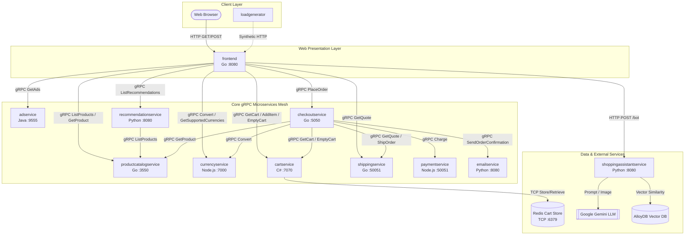
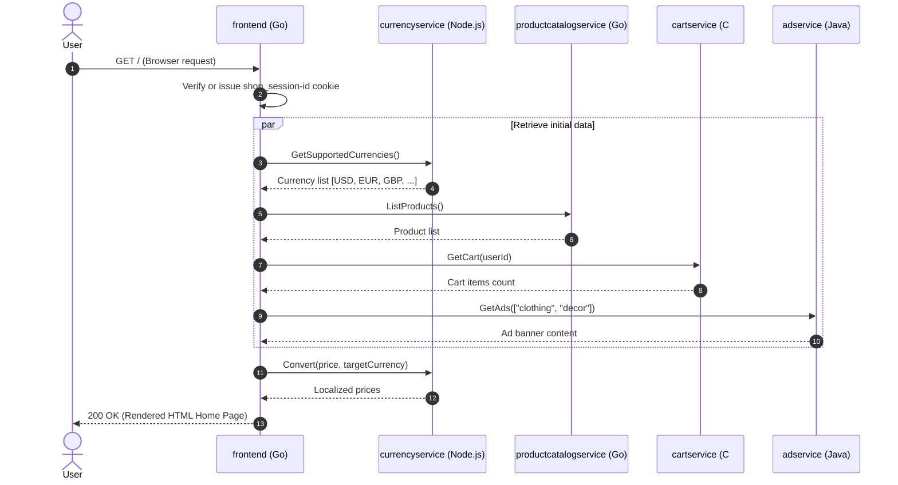
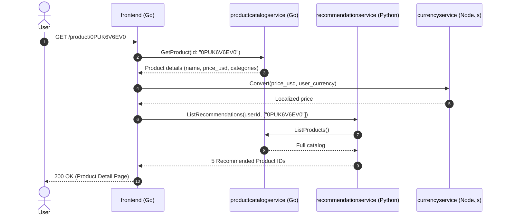
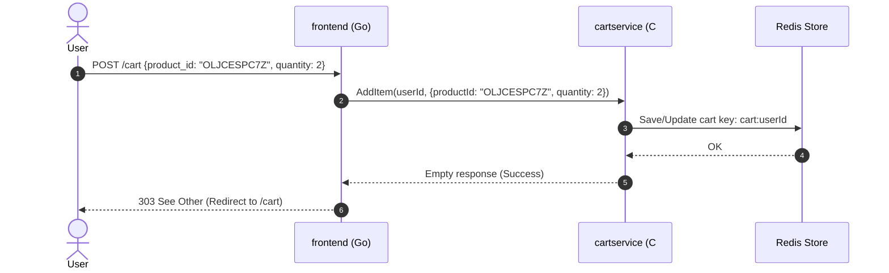
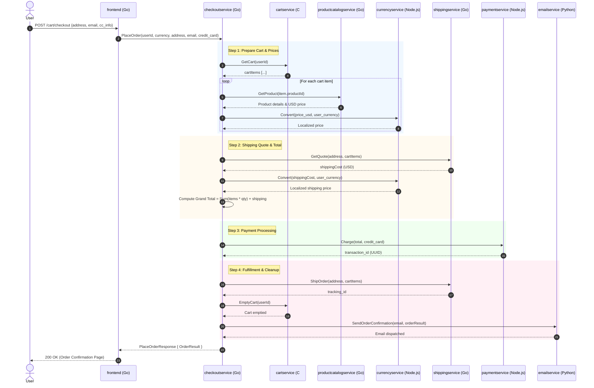

# Application Architecture & Execution Flows

This document details the architectural topology, patterns, and end-to-end execution journeys of the Online Boutique application.

---

## 1. Architectural Topology

---

## 2. Core Architectural Patterns

1. **Composite UI / Ingress Aggregator Pattern**:
   * The `frontend` acts as an API gateway and UI renderer. It receives browser HTTP requests, invokes multiple backend gRPC microservices concurrently, assembles the responses, and renders HTML server-side.
2. **Saga / Orchestration Pattern (`checkoutservice`)**:
   * Order placement involves multiple distributed participants (Cart, Catalog, Currency, Payment, Shipping, Email). The `checkoutservice` acts as a centralized orchestrator managing the workflow sequentially:
     1. Validate & retrieve cart
     2. Calculate totals and convert currency
     3. Authorize payment
     4. Book shipping label
     5. Clear cart
     6. Dispatch confirmation email
3. **Graceful Fallback & Fault Tolerance**:
   * **Non-critical failures**: If `adservice` or `recommendationservice` fails or times out, the `frontend` catches the gRPC exception, logs a warning, and renders the webpage without ads or recommendations.
   * **Critical failures**: Failures in `cartservice`, `productcatalogservice`, or `paymentservice` during checkout abort the transaction and display a structured error page (`HTTP 500`).
4. **Externalized Polyglot State**:
   * The web and business logic tiers maintain zero in-memory session data. State is externalized to Redis, allowing pods to be destroyed, rescheduled, or scaled without user data loss.

---

## 3. End-to-End User Journeys & Sequence Flows

### Journey A: User Opens the Home Page (`GET /`)

When a user visits the root URL:
1. `frontend` checks for the `shop_session-id` cookie. If not found, it generates a new UUID session token.
2. `frontend` calls `currencyservice.GetSupportedCurrencies()` to populate the currency selector dropdown.
3. `frontend` calls `productcatalogservice.ListProducts()` to retrieve all products.
4. For each product, `frontend` calls `currencyservice.Convert()` to display prices in the selected currency (default: USD).
5. `frontend` calls `cartservice.GetCart(sessionID)` to show current cart item count.
6. `frontend` calls `adservice.GetAds()` passing context keywords to load promotional banners.
7. HTML template `home` is rendered and returned to the browser.

---

### Journey B: User Browses a Product (`GET /product/{id}`)

1. Browser requests a product detail page.
2. `frontend` calls `productcatalogservice.GetProduct(id)`.
3. `frontend` converts product price using `currencyservice.Convert()`.
4. `frontend` calls `recommendationservice.ListRecommendations(userId, [id])`.
   * `recommendationservice` internally calls `productcatalogservice.ListProducts()` to fetch all items, filters out the current product ID, samples up to 5 recommendations, and returns them.
5. `frontend` calls `adservice.GetAds()` using product category context.
6. HTML template `product` is rendered and returned.

---

### Journey C: User Adds a Product to the Cart (`POST /cart`)

1. User submits product ID and quantity from the product page.
2. `frontend` validates form parameters (`product_id`, `quantity`).
3. `frontend` calls `cartservice.AddItem(userId, CartItem)`.
4. `cartservice` serializes the cart item and executes `HSET` / `SET` against the Redis store.
5. `frontend` redirects browser to `GET /cart`.
6. `frontend` calls `cartservice.GetCart(userId)` to fetch all items, computes line-item prices and totals via `productcatalogservice` and `currencyservice`, and renders the cart page.

---

### Journey D: User Completes Checkout (`POST /cart/checkout`)

This is the primary distributed transaction in the system:

---

### Journey E: Shopping Assistant Interaction (`POST /bot`)

1. User opens the Assistant page (`/assistant`), selects or uploads a room image, and enters a prompt.
2. Browser sends `POST /bot` with prompt and image URL.
3. `frontend` forwards the payload via HTTP `POST` to `http://${SHOPPING_ASSISTANT_SERVICE_ADDR}/`.
4. `shoppingassistantservice` performs multimodal RAG:
   * Calls Google Gemini Vision (`gemini-1.5-flash`) to generate a textual description of the room's style.
   * Runs similarity search against the AlloyDB vector database (`AlloyDBVectorStore`) using product embeddings (`models/embedding-001`).
   * Calls Gemini LLM with the retrieved product context and user query.
5. Returns JSON response containing recommendation text and suggested product IDs.
