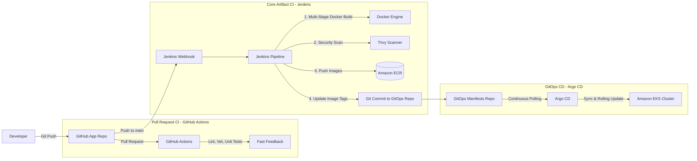
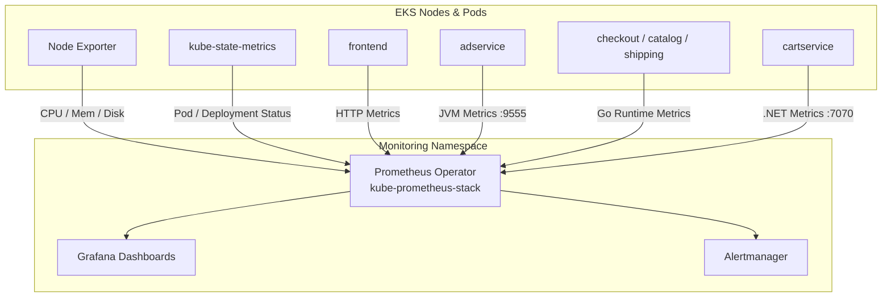
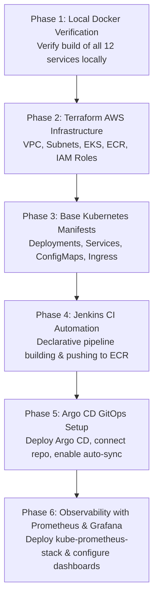

# AWS Cloud Architecture, CI/CD & Observability Plan

This document details the target architecture, infrastructure components, CI/CD delivery pipelines, and observability stack for deploying the Online Boutique microservices on **Amazon Web Services (AWS)**.

---

## 1. Proposed AWS Cloud Infrastructure (via Terraform)

```
+--------------------------------------------------------------------------------------------------+
|                                        AWS Region                                                |
|                                                                                                  |
|  +--------------------------------------------------------------------------------------------+  |
|  |                                          VPC                                               |  |
|  |                                                                                            |  |
|  |   +---------------------------------------+    +---------------------------------------+   |  |
|  |   |           Public Subnets              |    |           Private Subnets             |   |  |
|  |   |   (AZ-1a, AZ-1b, AZ-1c)               |    |   (AZ-1a, AZ-1b, AZ-1c)               |   |  |
|  |   |                                       |    |                                       |   |  |
|  |   |  +---------------------------------+  |    |  +---------------------------------+  |   |  |
|  |   |  |  Internet Gateway & NAT GW      |  |    |  |       Amazon EKS Cluster        |  |   |  |
|  |   |  +---------------------------------+  |    |  |  +---------------------------+  |  |   |  |
|  |   |                                       |    |  |  | Managed Node Group        |  |  |   |  |
|  |   |  +---------------------------------+  |    |  |  | (2-3x t3.large / m5.large)|  |  |   |  |
|  |   |  |  Application Load Balancer      |  |    |  |  |                           |  |  |   |  |
|  |   |  |  (AWS ALB Ingress Controller)   |--+----+->|  |  - Online Boutique Pods   |  |  |   |  |
|  |   |  +---------------------------------+  |    |  |  |  - Argo CD Controller     |  |  |   |  |
|  |   |                                       |    |  |  |  - Prometheus & Grafana   |  |  |   |  |
|  |   +---------------------------------------+    |  |  +---------------------------+  |  |   |  |
|  |                                                |  +---------------------------------+  |   |  |
|  |                                                |                                       |   |  |
|  |                                                |  +---------------------------------+  |   |  |
|  |                                                |  | Amazon ElastiCache (Redis)      |  |   |  |
|  |                                                |  | (Multi-AZ Replication Group)    |  |   |  |
|  |                                                |  +---------------------------------+  |   |  |
|  |                                                +---------------------------------------+   |  |
|  +--------------------------------------------------------------------------------------------+  |
|                                                                                                  |
|  +-------------------------------------------------+     +------------------------------------+  |
|  |       Amazon Elastic Container Registry         |     |          IAM & Security            |  |
|  |       (ECR - 11 Private Repositories)           |     |    (IRSA - Pod Roles & Policies)   |  |
|  +-------------------------------------------------+     +------------------------------------+  |
+--------------------------------------------------------------------------------------------------+
```

### Component Responsibilities

1. **Amazon VPC**:
   * Multi-AZ architecture spanning 3 Availability Zones for high availability.
   * **Public Subnets**: Host Internet Gateways, NAT Gateways, and the external Application Load Balancer.
   * **Private Subnets**: Isolate EKS worker nodes and database instances with no direct public route.
2. **Amazon EKS (Elastic Kubernetes Service)**:
   * Managed Kubernetes control plane (Kubernetes v1.28+).
   * **Managed Node Groups**: 2 to 4 worker nodes (e.g., `t3.large` or `m5.large`) running across private subnets. Provides compute for all 11 core microservices + observability pods.
3. **Amazon ECR (Elastic Container Registry)**:
   * Private container registries for each microservice image (`onlineboutique/frontend`, `onlineboutique/cartservice`, etc.).
   * Configured with image scanning on push and lifecycle policies to purge untagged builds.
4. **AWS Application Load Balancer (ALB)**:
   * Provisioned via the **AWS Load Balancer Controller** inside EKS. Routes public HTTP/HTTPS traffic to the `frontend` service on port `8080`.
5. **Amazon ElastiCache for Redis** *(Production Option)*:
   * Managed, high-availability Redis replication group deployed into private database subnets to persist shopping cart state for `cartservice` (`REDIS_ADDR`).
   * *Alternative (Development)*: In-cluster Redis deployment (`redis-cart:6379`) to minimize AWS cloud costs.
6. **IAM Roles for Service Accounts (IRSA)**:
   * Uses OpenID Connect (OIDC) federation to attach AWS IAM roles directly to Kubernetes Service Accounts, granting least-privilege permissions without embedding long-lived AWS keys in containers.

---

## 2. CI/CD Pipeline Architecture (Jenkins + Argo CD)

To maximize real-world DevOps value without redundant duplication between GitHub Actions and Jenkins, we divide responsibilities cleanly:



### Clean Division of Responsibilities

1. **GitHub Actions (Developer PR Feedback)**:
   * Triggers on Pull Requests.
   * Runs lightweight code validation: Go formatting/vetting, Node.js linting, Python flake8, and unit tests (`product_catalog_test.go`, `shippingservice_test.go`).
   * Gives developers immediate pass/fail feedback before code is merged into `main`.
2. **Jenkins (Heavyweight Build & Artifact Promotion)**:
   * Triggers on merged commits to `main`.
   * Manages heavy build workloads: builds Docker images for updated services.
   * Runs container vulnerability scanning (using Trivy).
   * Authenticates with AWS CLI (`aws ecr get-login-password`) and pushes tagged images (`${BUILD_NUMBER}-${GIT_COMMIT}`) to Amazon ECR.
   * Clones the GitOps repository/branch, updates the deployment manifest image tags, and pushes the commit.
3. **Argo CD (GitOps Continuous Delivery)**:
   * Deployed inside the EKS cluster (`argocd` namespace).
   * Watches the GitOps manifests repository.
   * Detects the new image tag committed by Jenkins and executes an automated, zero-downtime rolling update across the EKS pods.
   * Monitors cluster drift and automatically reconciles discrepancies.

---

## 3. Observability Architecture (Prometheus & Grafana)



### Metrics & Instrumentation Strategy

1. **Cluster & Infrastructure Metrics**:
   * Scraped via `node-exporter` (CPU saturation, memory pressure, disk I/O, network throughput per EC2 worker node).
   * Scraped via `kube-state-metrics` (Pod crash loops, deployment replicas, container restarts, resource quotas).
2. **Application Runtime Metrics**:
   * **Java (`adservice`)**: JVM garbage collection pauses, thread counts, heap utilization.
   * **Go Services (`frontend`, `checkoutservice`, `productcatalogservice`, `shippingservice`)**: Goroutine count, heap memory allocations, GC duration.
   * **Node.js (`currencyservice`, `paymentservice`)**: Event loop lag, active handles.
   * **C# (.NET `cartservice`)**: CLR thread pool status, GC allocations.
3. **RED Metrics (Rate, Errors, Duration)**:
   * **Rate**: Request throughput (QPS) on `frontend` and `currencyservice`.
   * **Errors**: HTTP 5xx rates and gRPC status codes (`UNAVAILABLE`, `DEADLINE_EXCEEDED`, `INTERNAL`).
   * **Duration**: p50, p95, and p99 request latency histograms across the checkout flow.
4. **Grafana Dashboards**:
   * Cluster Overview Dashboard (Node health and capacity).
   * Application Performance Monitoring (APM) Dashboard tracking business metrics:
     * Orders placed per minute
     * Failed checkout transactions
     * Average shopping cart size

---

## 4. Recommended Step-by-Step Implementation Roadmap

To build this architecture cleanly and avoid rework, follow this phased implementation order:



### Phase Breakdown

* **Phase 1: Local Verification**
  * Verify Docker builds for each microservice using the existing Dockerfiles.
* **Phase 2: Terraform Infrastructure**
  * Write modular Terraform configurations:
    * `vpc.tf`: Multi-AZ subnets, NAT Gateways, route tables.
    * `ecr.tf`: Repositories for all microservices.
    * `eks.tf`: EKS cluster and managed node group.
    * `iam.tf`: IRSA roles for AWS Load Balancer Controller.
* **Phase 3: Kubernetes Manifests (`k8s/`)**
  * Structure base manifests for all 11 services + in-cluster Redis + Ingress.
  * Ensure all mandatory environment variables (including `SHOPPING_ASSISTANT_SERVICE_ADDR`) are populated.
* **Phase 4: Jenkins Pipeline (`jenkins/`)**
  * Create a modular `Jenkinsfile` that builds changed services, tags images with build metadata, and pushes to ECR.
* **Phase 5: Argo CD Deployment**
  * Deploy Argo CD to EKS, register the manifest repository, and verify automated rollouts.
* **Phase 6: Prometheus & Grafana Monitoring**
  * Install `kube-prometheus-stack` Helm chart; create custom ServiceMonitors and import Grafana dashboards.

---

## 5. Technical Risks & Mitigation Strategies

1. **Risk: `SHOPPING_ASSISTANT_SERVICE_ADDR` Panic**:
   * *Issue*: `frontend` panics at startup if this variable is missing.
   * *Mitigation*: Always define `SHOPPING_ASSISTANT_SERVICE_ADDR: "disabled:8080"` in the frontend manifest even if the AI service is disabled.
2. **Risk: gRPC Probes on AWS EKS**:
   * *Issue*: Standard Kubernetes HTTP probes do not work directly against gRPC ports.
   * *Mitigation*: Kubernetes 1.24+ natively supports `grpc` probes:
     ```yaml
     livenessProbe:
       grpc:
         port: 5050
       initialDelaySeconds: 10
     ```
3. **Risk: High EKS Compute Costs**:
   * *Issue*: 11 microservices + monitoring pods can consume significant CPU/RAM if resource requests are too high.
   * *Mitigation*: Define conservative resource requests (e.g., `cpu: 50m`, `memory: 64Mi` per service) so the entire application runs smoothly on two `t3.large` nodes ($0.0832/hr each) with automated teardown scripts.
