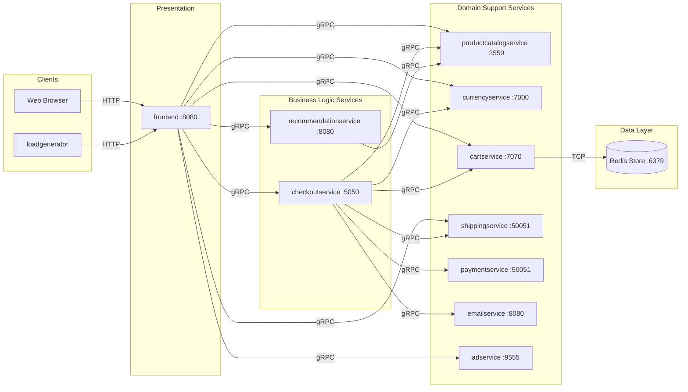

# Service Communication & Network Matrix

This document defines the network interactions, gRPC RPC contracts, communication protocols, and service discovery mechanisms within the Online Boutique application.

---

## 1. Service Communication Matrix

| Caller Service | Callee Service | Protocol | Default Port | Environment Variable | RPC Method / HTTP Route | Payload / Description | Failure Impact |
| :--- | :--- | :--- | :--- | :--- | :--- | :--- | :--- |
| **`frontend`** | `productcatalogservice` | gRPC | `3550` | `PRODUCT_CATALOG_SERVICE_ADDR` | `ListProducts`, `GetProduct`, `SearchProducts` | Product ID / query string; returns product catalog objects. | **Critical**: HTTP 500 error page. |
| **`frontend`** | `currencyservice` | gRPC | `7000` | `CURRENCY_SERVICE_ADDR` | `GetSupportedCurrencies`, `Convert` | Currency code, Money amount; returns converted Money. | **Critical**: HTTP 500 error page. |
| **`frontend`** | `cartservice` | gRPC | `7070` | `CART_SERVICE_ADDR` | `GetCart`, `AddItem`, `EmptyCart` | User session ID, CartItem; returns cart items. | **Critical**: HTTP 500 error page. |
| **`frontend`** | `recommendationservice` | gRPC | `8080` | `RECOMMENDATION_SERVICE_ADDR` | `ListRecommendations` | User ID, list of viewed product IDs; returns 5 product IDs. | **Non-Critical**: Logs warning, omits recommendation widget. |
| **`frontend`** | `adservice` | gRPC | `9555` | `AD_SERVICE_ADDR` | `GetAds` | Context keywords; returns ad text and redirect URLs. | **Non-Critical**: Logs warning, omits ad banner. |
| **`frontend`** | `shippingservice` | gRPC | `50051` | `SHIPPING_SERVICE_ADDR` | `GetQuote` | Destination address, items; returns shipping cost. | **Critical**: Breaks checkout price calculation. |
| **`frontend`** | `checkoutservice` | gRPC | `5050` | `CHECKOUT_SERVICE_ADDR` | `PlaceOrder` | User ID, currency, address, email, credit card info; returns OrderResult. | **Critical**: Order failure page. |
| **`frontend`** | `shoppingassistantservice` | HTTP | `8080` | `SHOPPING_ASSISTANT_SERVICE_ADDR` | `POST /` | JSON `{ message, image }`; returns AI assistant recommendation. | **Non-Critical**: Assistant tab shows error. |
| **`checkoutservice`** | `cartservice` | gRPC | `7070` | `CART_SERVICE_ADDR` | `GetCart`, `EmptyCart` | User ID; retrieves cart items and empties cart on success. | **Critical**: Order aborted. |
| **`checkoutservice`** | `productcatalogservice` | gRPC | `3550` | `PRODUCT_CATALOG_SERVICE_ADDR` | `GetProduct` | Product ID; fetches product details and unit price. | **Critical**: Order aborted. |
| **`checkoutservice`** | `currencyservice` | gRPC | `7000` | `CURRENCY_SERVICE_ADDR` | `Convert` | Money object, target currency; converts price. | **Critical**: Order aborted. |
| **`checkoutservice`** | `shippingservice` | gRPC | `50051` | `SHIPPING_SERVICE_ADDR` | `GetQuote`, `ShipOrder` | Address, items; quotes cost and returns package tracking ID. | **Critical**: Order aborted. |
| **`checkoutservice`** | `paymentservice` | gRPC | `50051` | `PAYMENT_SERVICE_ADDR` | `Charge` | Total Money, CreditCardInfo; validates card and charges. | **Critical**: Order aborted (credit card declined). |
| **`checkoutservice`** | `emailservice` | gRPC | `8080` | `EMAIL_SERVICE_ADDR` | `SendOrderConfirmation` | Email address, OrderResult; sends confirmation email. | **Non-Critical**: Logs warning, checkout still succeeds. |
| **`recommendationservice`** | `productcatalogservice` | gRPC | `3550` | `PRODUCT_CATALOG_SERVICE_ADDR` | `ListProducts` | Empty; retrieves all products for random sampling. | **Non-Critical**: Recommendation list returns empty. |
| **`cartservice`** | `redis` / ElastiCache | TCP | `6379` | `REDIS_ADDR` | Redis Commands (`HSET`, `HGET`, `DEL`) | Serialized Cart protobuf bytes stored by user ID key. | **Critical** (unless in-memory fallback enabled). |
| **`loadgenerator`** | `frontend` | HTTP | `8080` | `FRONTEND_ADDR` | HTTP GET / POST | Web browsing flows (`/`, `/product/*`, `/cart`, `/cart/checkout`). | **None**: Load simulation only. |

---

## 2. Complete Service Dependency Graph



---

## 3. Service Discovery & Networking Mechanics

### 1. Kubernetes CoreDNS Resolution
Within a Kubernetes cluster (e.g., Amazon EKS), services do not use hardcoded IP addresses or external service registries (like Consul or Eureka). Instead, they rely on standard **Kubernetes ClusterIP Services** and **CoreDNS**:
* When a service environment variable is configured as `PRODUCT_CATALOG_SERVICE_ADDR="productcatalogservice:3550"`, Kubernetes CoreDNS resolves `productcatalogservice` to the stable ClusterIP of the catalog service within the same namespace.
* Across namespaces, standard FQDNs can be used: `<service-name>.<namespace>.svc.cluster.local:<port>`.

### 2. gRPC Client Connection Pattern (Go Services)
In both `frontend` and `checkoutservice`, gRPC connections are established at application startup using:
```go
func mustConnGRPC(ctx context.Context, conn **grpc.ClientConn, addr string) {
    var err error
    _, cancel := context.WithTimeout(ctx, time.Second*3)
    defer cancel()
    *conn, err = grpc.NewClient(addr,
        grpc.WithTransportCredentials(insecure.NewCredentials()),
        grpc.WithStatsHandler(otelgrpc.NewClientHandler()))
    if err != nil {
        panic(errors.Wrapf(err, "grpc: failed to connect %s", addr))
    }
}
```
* **Transport Security**: Uses `insecure.NewCredentials()` for internal pod-to-pod plaintext communication. In production, transport security can be added via a Service Mesh (e.g., Istio / AWS App Mesh with mutual TLS) without modifying code.
* **OpenTelemetry Instrumentation**: The `otelgrpc.NewClientHandler()` automatically injects W3C trace headers into outbound gRPC metadata.

---

## 4. Critical Startup Hazards & Technical Gotchas

### Hazard 1: `mustMapEnv` Startup Panics
In both `frontend` and `checkoutservice`, environment variables are read using a strict helper:
```go
func mustMapEnv(target *string, envKey string) {
    v := os.Getenv(envKey)
    if v == "" {
        panic(fmt.Sprintf("environment variable %q not set", envKey))
    }
    *target = v
}
```
* **Critical Finding**: If ANY of the required environment variables are missing from a Kubernetes Deployment manifest, the container immediately **panics and enters a `CrashLoopBackOff` state**.
* **Special Case**: `frontend` explicitly calls `mustMapEnv(&svc.shoppingAssistantSvcAddr, "SHOPPING_ASSISTANT_SERVICE_ADDR")`. Even if you are not deploying or using `shoppingassistantservice`, you MUST provide a non-empty placeholder value (e.g., `SHOPPING_ASSISTANT_SERVICE_ADDR="disabled:8080"`) or the `frontend` pod will fail to start.

### Hazard 2: `recommendationservice` Startup Exception
In `src/recommendationservice/recommendation_server.py`:
```python
catalog_addr = os.environ.get('PRODUCT_CATALOG_SERVICE_ADDR', '')
if catalog_addr == "":
    raise Exception('PRODUCT_CATALOG_SERVICE_ADDR environment variable not set')
```
If `PRODUCT_CATALOG_SERVICE_ADDR` is missing from the `recommendationservice` deployment, the Python process raises an uncaught exception and terminates.
